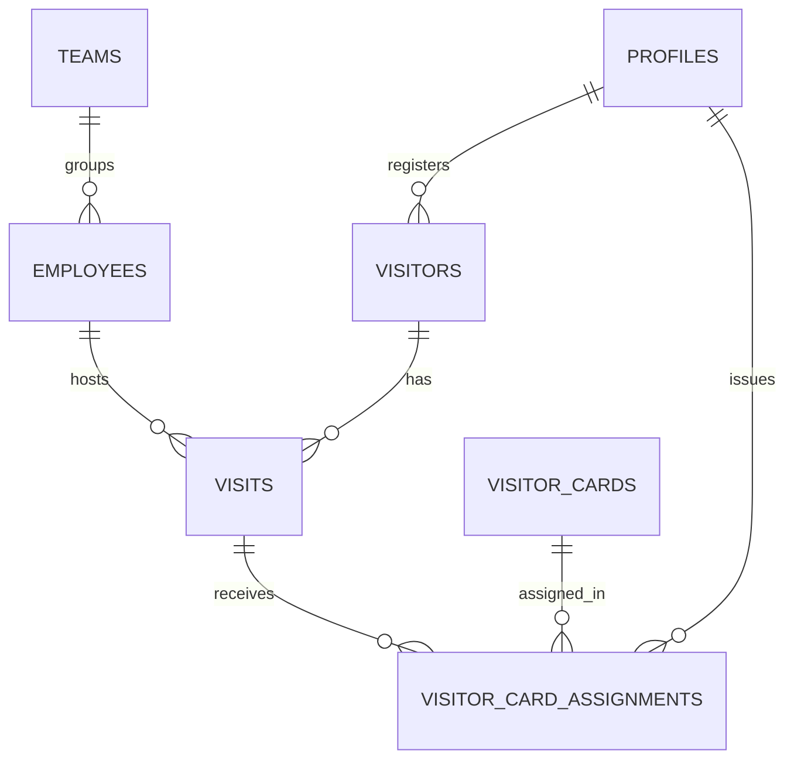

# NagorikPass — Database Schema Design

## 1. Status
**Proposed logical model — not yet an approved migration.** The PRD defines required information and workflows, but does not prescribe exact table names or every field type. Review this design before creating production tables.

## 2. Design principles
- Use UUID primary keys unless a reviewed reason suggests otherwise.
- Add created/updated timestamps to managed records.
- Use foreign keys for relationships.
- Enforce unique card numbers in the database.
- Use database constraints and transaction-safe functions for critical business rules.
- Keep employee private information inaccessible to Receptionist role.
- Avoid storing unnecessary personal data.
- Confirm retention and deletion rules with the product owner.

## 3. Proposed entities
### `profiles`
Application profile linked to Supabase Auth user.
- `id` — UUID, references `auth.users.id`
- `full_name`
- `role` — proposed enum: `admin`, `receptionist`, `employee`
- `team_id` — optional, if teams are modeled
- timestamps

### `employees`
Employee directory data needed by the application.
- `id`
- `profile_id` — optional link to profile, depending on account model
- `full_name`
- `team_id`
- other employee fields only after requirements are approved

### `teams`
- `id`
- `name`

### `visitors`
Visitor identity/contact information and visit classification.
- `id`
- `full_name` (required)
- `phone_number` (required)
- `purpose` (required)
- `visitor_type` (required; values based on PRD categories)
- `guest_count` (additional field; validation range to be decided)
- `company_organization` (optional)
- `invited_by_employee_id` (optional until host resolution)
- `registered_by_profile_id`
- `registration_source` (proposed: admin, employee, receptionist, import)
- timestamps

### `visits`
A visit occurrence and its lifecycle.
- `id`
- `visitor_id`
- `host_employee_id` (nullable if unresolved; behavior must follow PRD contact-HR process)
- `scheduled_arrival_at` (optional until confirmed)
- `scheduled_departure_at` (optional until confirmed)
- `checked_in_at`
- `checked_out_at`
- `status` (proposed: expected, checked_in, checked_out, rejected/cancelled only if approved)
- `created_by_profile_id`
- timestamps

### `visitor_cards`
- `id`
- `card_number` — unique, required
- `status` — `available` or `issued`
- timestamps

### `visitor_card_assignments`
Immutable history of card assignment/return.
- `id`
- `visitor_card_id`
- `visit_id`
- `issued_at`
- `returned_at` (nullable until returned)
- `issued_by_profile_id`
- `returned_by_profile_id` (nullable)
- timestamps

### `interview_imports` (proposed)
Tracks Excel import batch metadata and result summary. Exact fields depend on import requirements.

### `notifications` (proposed)
Tracks notification intent/delivery status if in-app or provider delivery history is required. Exact provider payload retention must be reviewed for privacy.

## 4. Relationship overview

## 5. Required constraints and invariants
- `visitor_cards.card_number` must be unique.
- A card can have at most one active assignment (no returned_at) at a time.
- A card can only be assigned when its current status is Available.
- A card status of Issued must correspond to one active assignment.
- A visitor visit cannot be checked out unless card return is confirmed, when a card was issued.
- Delivery/Courier visits cannot transition to Checked In and cannot receive card assignments.
- Check-in and card assignment must be atomic.
- Check-out and card return must be atomic.
- Employee registration must not require an HR approval record.
- Receptionist employee lookup must expose only name and team.

## 6. RLS policy matrix — starting point for review
| Data | HR/Admin | Receptionist | Employee |
|---|---|---|---|
| Visitor records | Manage/view all per policy | View and create operational records as required | Create and view own registered visitors |
| Visits | Manage/view all | View expected and operational visits; update check-in/out | View own registered visitors/visits |
| Employee directory | Manage | Read name and team only | Scope to approved requirement |
| Visitor cards | Manage/register/import | Read available cards; issue/return through protected operation | No access unless required |
| Card assignment history | View all | Create operational issue/return; view only needed details | No access unless required |
| Reports/settings | Manage | No access unless explicitly approved | No access unless explicitly approved |

This matrix is a proposal. Convert each row into explicit RLS policies and test them with separate role accounts. Do not treat frontend route guards as sufficient.

## 7. Questions before migration
- Can one visitor have multiple visits? The proposed model supports it.
- Are visitor identity records reused across visits?
- Can one VIP/group visit have multiple individual visitor names/cards?
- What exact employee fields exist, and which are private?
- How are user accounts created, invited, disabled, and reassigned?
- What are the allowed visitor/visit status transitions?
- What is the retention policy for visitor and card history?

---

## Existing schema and the proposed change — 2026-11-04

The sections above were written for a greenfield Supabase project. A PostgreSQL schema already exists (`backend/migrations/001`–`007`). This section maps the proposal onto it. **Nothing here is applied, and no migration has been written.** Migrations only move forward: a new numbered file is added, and an applied one is never edited.

### Proposed entities against what exists

| Proposed above | Exists as | Notes |
|---|---|---|
| `profiles` (role, linked to `auth.users`) | `users` (`role` in admin, receptionist, employee; `employee_id`) plus `sessions` | Custom password hash and session table. Becomes `profiles` only if DEC-001 = Supabase. |
| `employees` | `employees` (code, name, department, designation, official email, phone, active) | Already separate from accounts. Official email and phone are the private fields. |
| `teams` | `employees.department` | Assumed to be "team" (DEC-007). A teams table is only needed if you want one. |
| `visitors` | `visitors` (name, email, phone, company; unique on lower name plus phone) | Returning visitors are matched, so one person has many visits. |
| `visits` | `visits` (type, status, purpose, `visit_date`, `expected_time`, `scheduled_minutes`, `check_in_at`, `check_out_at`) | The proposal puts purpose and visitor type on `visitors`; the code puts `purpose` on `visits`. Keep per visit: the same person can come as a candidate and later a vendor. |
| `visitor_cards` | **missing** | |
| `visitor_card_assignments` | **missing** | |
| `interview_imports` | **missing** | |
| `notifications` | `notifications` (type, visit, employee or user, recipient, subject, status, error) | Stores no message bodies. Types change (below). |

### Existing tables the proposal does not mention

| Table | Holds | Under the PRD |
|---|---|---|
| `visit_hosts` | Employees selected as hosts, with a position | Keep or collapse to one Invited By (DEC-004) |
| `approvals` | One row per host with a hashed single-use link token | **Obsolete** (DEC-003) |
| `approval_decisions` | Immutable record of every host, admin, entry and request decision | **Obsolete** for the old flow. Keep the history already stored. |
| `visitor_logs` | Activity per visit, shown in visit details | Keep |
| `audit_log` | Sign-ins, password and account changes, settings changes | Keep |
| `app_settings` | Organization name, reception location, default visit length, email toggles, sender name, approval rule, link expiry | Approval rule and link expiry become obsolete |

### Proposed forward migration (sketch)

**On `visits`** (per occurrence)
- `category` text, one of: business_meeting, job_interview, vip_visit, vendor_supplier, maintenance_technician, personal_guest, delivery_courier, other. Existing rows need a default (DEC-006 to confirm: `other`).
- `guest_count` integer, at least 1, default 1. VIP or group expected and actual counts per DEC-005.
- `invited_by_employee_id` (nullable, references `employees`) and `invited_by_name` text for "employee not found". A check that at least one of them is set.
- `type` gains `import`.

**On `visitors`**: `company` becomes nullable; `email` stays nullable (DEC-006).

**New `visitor_cards`**: `id`, `card_number` text not null, unique on `lower(card_number)`, `status` in (`available`, `issued`), timestamps.

**New `visitor_card_assignments`** (rows are only ever inserted, and returned once)
- `id`, `card_id`, `visit_id`, `issued_at`, `returned_at` (null until returned), `issued_by`, `returned_by`.
- A partial unique index allows **one open assignment per card**, and another **one open assignment per visit**.
- A check that `returned_at` is not before `issued_at`.

**Constraints and functions**
- A Delivery/Courier visit can never reach `checked_in` or hold a card, enforced by a CHECK or trigger so no application code can bypass it.
- `check_in_visit(visit, card)`: one transaction. Lock the card row, require status `available`, reject delivery, insert the assignment, set the card `issued`, set the visit `checked_in` with the time.
- `check_out_visit(visit, card_returned)`: one transaction. If `card_returned` is false, change nothing and report an incomplete check-out. If true, close the assignment, set the card `available`, set the visit `checked_out`.
- Invariant: a card is `issued` exactly when it has an open assignment. A trigger or a test must prove this.
- `notifications.type` gains a check-in alert type; the host-arrival type is retargeted (HR/Admin and the registering employee).

**Approval objects** stay until DEC-003 is decided. Then drop or archive them in their own migration, keeping `approval_decisions` history readable.

### RLS, if DEC-001 = Supabase
The matrix in section 6 above is the starting point. Translating it needs the `auth` schema (`auth.uid()`), which plain PostgreSQL does not have. It can only be tested against a Supabase stack. Row security must also keep official email and phone out of every receptionist and employee read, including through joins and search.

### Open items before writing the migration
DEC-003 (what remains of approvals), DEC-004 (hosts), DEC-005 (group model), DEC-006 (optional fields, default category, import tables) and DEC-007 (team).

---

## Implemented — 2026-11-04

The migration sketched above has been written for Supabase, as a fresh schema rather than a change to the
Express one: `supabase/migrations/20261104090000_core_schema.sql`, `20261104090100_visit_functions.sql`,
`20261104090200_rls_and_grants.sql`. How it works, and how it is tested: `supabase/README.md`. What it
assumes while questions are open: `docs/IMPLEMENTATION_TRACKER.md`. Differences from the sketch: `category`,
`guest_count`, `company_organization` and the invited-by columns are on `visits`; there is no import table yet;
there is no employee code, designation or approval table; the notification table records who must be told and
has no delivery fields yet.
