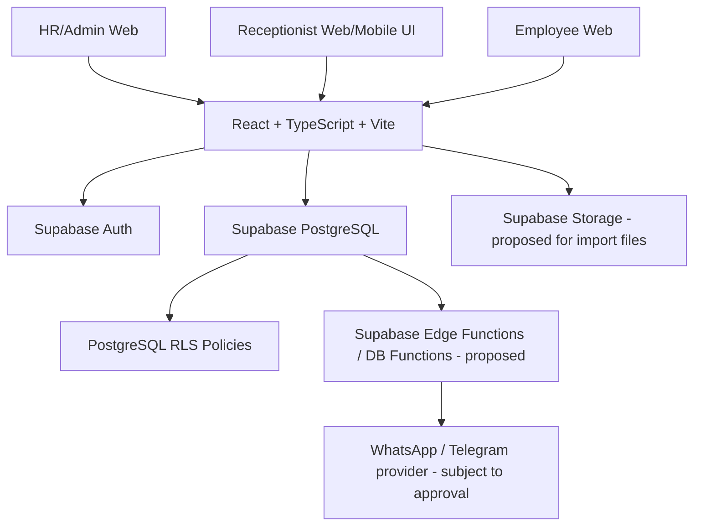

# NagorikPass — System Architecture

## 1. Status
**Proposed architecture for review.** The PRD confirms React + TypeScript + Vite, Supabase, PostgreSQL, Supabase Auth, and role-based access control. Detailed module boundaries and implementation patterns below are recommendations and require approval before they become binding.

## 2. High-level architecture


## 3. Frontend organization (proposed)
```text
src/
  app/
  assets/
  components/
    ui/
    layout/
    data-display/
    forms/
  features/
    auth/
    dashboard/
    visitors/
    visitor-cards/
    employees/
    receptionists/
    reports/
    notifications/
  hooks/
  lib/
    supabase/
  routes/
  services/
  types/
  utils/
```
Use feature-based modules. Keep shared UI components separate from domain-specific features.

## 4. Role-based application areas
- HR/Admin area: administration, visitor/card management, imports, reports, settings.
- Receptionist area: expected visitors, unscheduled registration, check-in/out, card return confirmation.
- Employee area: visitor registration and own visitor list.

Role-aware navigation is a usability measure, not a security boundary. Supabase RLS must enforce access.

## 5. Data flow principles
- Authenticate users with Supabase Auth.
- Resolve the authenticated user's application role through a protected profile/role model.
- Read/write data through Supabase client under RLS.
- Put critical multi-row operations (card assignment + visitor check-in; card return + visitor check-out) behind a transaction-safe database function or equivalent approved server-side operation.
- Store timestamps consistently; define the display timezone with the product owner.
- Send external notifications through a secure server-side integration, never expose provider secrets in the browser.

## 6. Critical operations
### Check-in
Must atomically validate visitor eligibility, ensure the selected card is Available, assign it, set card to Issued, set visitor to Checked In, and record timestamps/history. Prevent race conditions where two receptionists try to issue the same card.

### Check-out
Must require explicit card-return confirmation. If confirmation is No, do not change visitor or card status. If Yes, atomically record return, set card Available, and set visitor Checked Out.

### Delivery restriction
Block check-in and card assignment for Delivery/Courier visitor category at the authoritative database/business-logic layer, not only in the UI.

## 7. External integrations
WhatsApp/Telegram notifications are conditional in the PRD ("if integration is available"). Provider selection, credentials, approved message templates, delivery retries, and fallback behavior are unresolved. Keep integration behind a service boundary and do not hardcode a provider before approval.

## 8. Architecture decisions requiring approval
- Responsive web vs PWA vs separate native receptionist app.
- Exact profile/role schema and account provisioning flow.
- Whether to use Supabase Edge Functions, PostgreSQL functions, or both for critical workflows.
- Whether Supabase Storage is used for Excel upload staging.
- Notification provider and retry/fallback behavior.
- Audit logging scope and retention.

---

## Current implementation and the Supabase decision — 2026-11-04

The architecture above is a proposal for a Supabase build. The application that exists is different.

### What exists
```text
React + TypeScript + Vite (frontend/)
   |  HTTP /api, cookie session
Express + TypeScript (backend/src: routes, services, middleware, lib)
   |  node-postgres
PostgreSQL (backend/migrations 001-007)
```
- Authentication: password hashing, hashed session tokens in `sessions`, login rate limit, forced first-login password change.
- Authorization: `requireRole` on every route, plus per-row scoping in services (an employee sees only visits they requested or host). The frontend `RequireRole` only controls navigation.
- Atomic operations: check-in is a single guarded `UPDATE`; approvals lock rows with `FOR UPDATE`.
- Email: a transport with SMTP, an in-memory development mailbox, console, or off. Failures are recorded and never fail the visit.
- Reports: PDF, DOCX and CSV built on the server.
- Folder layout is by technical layer (`pages`, `components`, `lib`, `api`), not by feature as proposed above. Changing it is not required.

### The decision (DEC-001)
The PRD and `CLAUDE.md` name Supabase PostgreSQL, Supabase Auth and database policies. Nothing in the repository uses Supabase.

| | A. Migrate to Supabase | B. Keep Express and PostgreSQL | C. Express first, then migrate |
|---|---|---|---|
| Meets PRD §8 and `CLAUDE.md` | Yes | No, needs the PRD amended | Yes, after the second step |
| Authorization lives in | RLS and database functions | Express route guards | Express, then RLS |
| Reusable from today | SQL schema, constraints, frontend UI, design tokens | Almost everything | Almost everything, then SQL |
| Rewritten | Routes, services, auth, email, reports (Edge Functions), about 125 backend test cases, frontend data layer | Only the approval and card logic | Same as B, then the migration |
| Testing authorization | Needs Supabase CLI and Docker, or a hosted test project | Existing supertest matrix | Both |
| Extra dependency | `@supabase/supabase-js` | none | `@supabase/supabase-js` later |
| Main risk | Largest change and a new platform | Silently drops a stated requirement | Auth and tests built twice |

In every option the card rules belong in the database (constraints and atomic functions), so write them as plain SQL first. They work on any PostgreSQL and move to Supabase unchanged.

Under A, PDF, DOCX, email and Excel parsing move to Edge Functions or a small server, because the browser cannot hold provider secrets. That is a second architectural decision inside DEC-001.

### Unchanged by the PRD
Role-aware navigation is still a convenience, not a security boundary. Notification delivery stays behind a service boundary so a WhatsApp or Telegram provider can be added once chosen (DEC-008). Provider secrets stay on the server.
