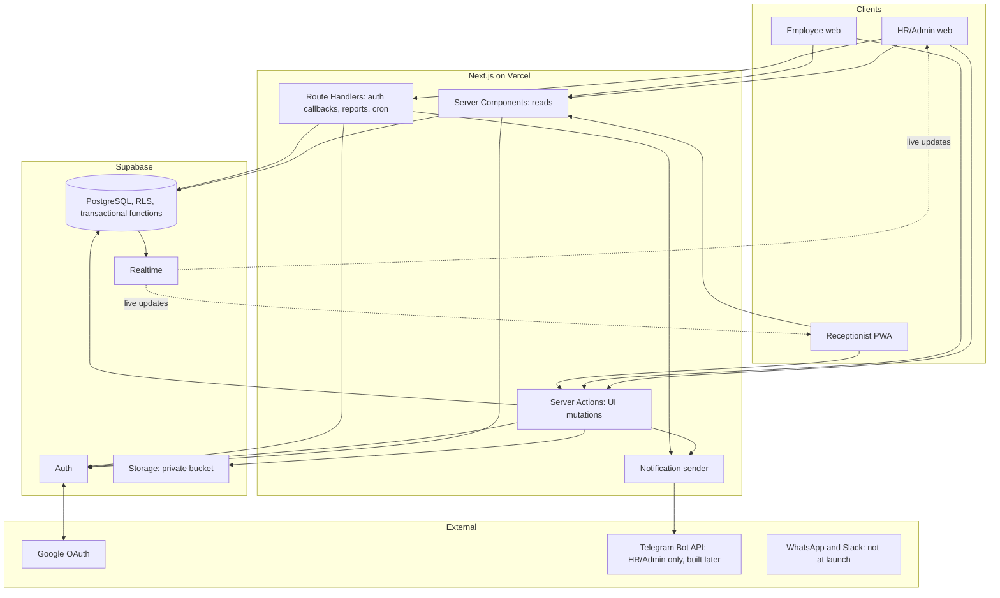
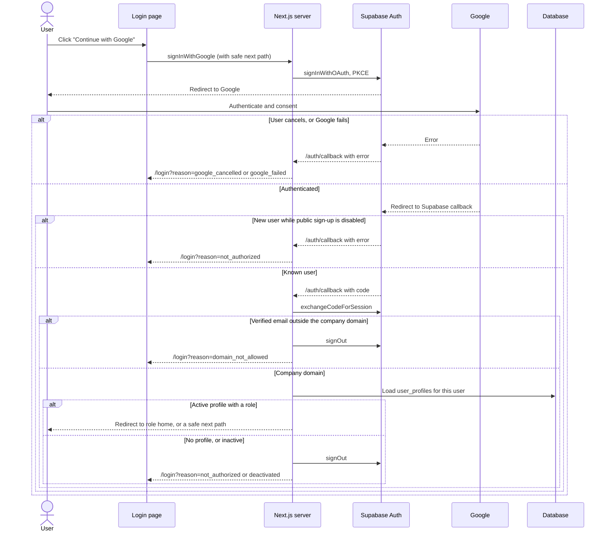

# 02. Technical Architecture

Part of the [Development PRD](DEVELOPMENT_PRD.md). This describes the target design, not the code currently in the repository.

## Overview



## Frontend

- One Next.js application with route groups per role: `/admin`, `/reception`, `/employee`, plus `/login` and `/auth`.
- Server Components by default. Client components only for interaction and Realtime.
- Presentation components hold no business logic.
- Visual rules are in [11-ui-design-system.md](11-ui-design-system.md).

## Backend

| Mechanism | Used for |
|---|---|
| Server Components | Reads under the user's session |
| Server Actions | Every mutation started from the UI |
| Route Handlers | Only what needs a URL: auth callbacks, file downloads, scheduled jobs |
| Postgres functions | Every visit and card state change, in one transaction |

There is no public or third-party API.

## Authentication

Supabase Auth handles identity, using `@supabase/ssr` for cookie sessions. The request proxy refreshes the session and knows only whether a valid session exists. Roles are checked on the server against the database.

### Sign-in methods

| Method | Starts at | Ends at |
|---|---|---|
| Email and password | `signIn` | Role check, then role home |
| Continue with Google (DEC-G1) | `signInWithGoogle` | `GET /auth/callback`, company-domain check (OQ-11), role check, then role home |
| Invitation (first access) | Email link | `GET /auth/confirm`, then set password |

`/auth/confirm` and `/auth/callback` are separate because they do different jobs. `/auth/confirm` leads to setting a password, and using it for Google would send people to the wrong page.

### Google Sign-In flow



Steps:

1. The user opens the login page and clicks **Continue with Google**.
2. `signInWithGoogle` asks Supabase Auth to start Google OAuth, with `/auth/callback` as the return address. It passes the company domain as Google's `hd` hint, which only narrows the account picker.
3. The user authenticates with Google.
4. Google returns to Supabase's own callback URL, and Supabase redirects to `/auth/callback` with a one-time code.
5. `/auth/callback` exchanges the code, which establishes the session cookie.
6. The server checks that the verified email belongs to the company domain (`COMPANY_EMAIL_DOMAIN`, a placeholder until the owner provides it). A personal or other-domain Google account is signed out and denied (OQ-11, OQ-12).
7. The server loads the user's `user_profiles` row. Identity and domain alone give nothing.
8. If the profile is active, the user goes to their role home: `/admin`, `/reception` or `/employee`.
9. Otherwise the session is ended and the user sees a denial message. No account, profile or role is created.

Account linking rules are in [04-user-roles-and-permissions.md](04-user-roles-and-permissions.md#account-authorization). Security rules are in [07-security-guidelines.md](07-security-guidelines.md#google-oauth).

### Sign-out

`signOut` ends the session and clears its cookies, whichever method was used. It does not sign the user out of Google.

## Authorization

Three layers:

1. **UI:** hides what a role can't use. This is a convenience, not security.
2. **Server:** each Server Action and Route Handler loads the active profile and checks the permission.
3. **Database:** RLS and functions make the final decision, even if the first two layers are wrong.

## Data access

- Normal reads and writes use the signed-in user's session.
- `visits`, `visitors`, `card_assignments` and card status can't be written directly by users. Changes go through functions in [03-database-design.md](03-database-design.md).
- The service-role key is used only in server-only modules, for invitations, account activation, scheduled jobs and notification status updates.

## Validation

Zod schemas shared by client and server give the same rules and messages in both places. Database constraints have final say.

- **Visitor phone (OQ-5):** Bangladeshi mobile numbers only. Input such as `01712-345678`, `8801712345678` or `+880 1712 345678` is normalized on the server to `+8801712345678` before it reaches the database. International numbers are refused.
- **Email addresses (OQ-12):** invitations and employee records accept only addresses in the company domain.

## Error handling

Actions return a typed result:

```ts
type ActionResult<T> =
  | { ok: true; data: T }
  | { ok: false; code: string; message: string; fieldErrors?: Record<string, string> }
```

Database error names such as `card_not_available` map to safe messages. Internal details are logged, never shown. Every screen handles loading, empty, success and error states.

## File upload and Excel import

1. HR/Admin uploads `.xlsx` to a Server Action.
2. The server checks size, type and row count, stores the original in a private bucket (DEC-Q18), and creates an `import_batches` row.
3. ExcelJS parses the file on the server. Only cell values are read; formulas are never evaluated.
4. Each row is validated and imported separately. Valid rows import and rejected rows are saved with reasons (DEC-Q13).

Next.js limits Server Action body size and Vercel limits request size, so the upload limit must be set within both during implementation. Old `.xls` files aren't supported because ExcelJS doesn't read them.

## Notification delivery

Only HR/Admin receives notifications (OQ-3). Employees and hosts are never notified, so there is no employee linking and no employee delivery to fail or retry (OQ-4). The owner will implement Telegram later; the steps below are the design it plugs into. Until then the PRD's manual fallback applies: the Receptionist calls HR/Admin, and the call isn't recorded (OQ-9).

1. `check_in_visit` writes one HR/Admin `notification_deliveries` row in the same transaction as the check-in.
2. After it commits, the action sends the message through a channel adapter. Telegram is the only planned adapter.
3. Results are saved on the row. A provider failure can't undo or block a check-in.
4. Failures appear on the reception screen, where the Receptionist can retry or use the manual fallback.
5. A scheduled job retries failed rows. Frequency depends on the Vercel plan, which is undecided (OQ-14).

**Recipient.** One HR/Admin Telegram chat ID, entered in Settings. A bot can only message a chat that has started it, so HR/Admin adds the bot to that chat during setup.

**Host deactivation notice (OQ-8).** Deactivating an employee writes an HR/Admin delivery row (event `host_deactivated`) for each of their upcoming `expected` visits, through the same channel. The deactivation result also lists those visits to the HR/Admin who made the change.

## Real-time updates

The HR/Admin dashboard and reception lists subscribe to `visits` and `visitor_cards`. RLS filters what each subscriber receives. A change prompts a refresh through the normal read path, so no private data depends on the event payload.

## Scheduled jobs

Vercel Cron calls these with `GET`, secured by `CRON_SECRET`:

| Route | Schedule | Work |
|---|---|---|
| `/api/cron/mark-no-shows` | `5 18 * * *` (00:05 Asia/Dhaka) | `mark_no_shows()` |
| `/api/cron/retry-notifications` | Depends on plan (OQ-14, pending) | Retries failed HR/Admin deliveries |

## PDF and Excel reports

- **PDF: PDFKit (DEC-T3).** One package with built-in tables, generated on the server after a permission check, so report data never depends on the browser. Version 0.20.2 was confirmed to include `table()`. Bundling with Next.js on Vercel must be proven in Phase 7 because it loads font files at runtime.
- **Excel: ExcelJS**, already in the stack. Values that start with `=`, `+`, `-` or `@` are escaped so a spreadsheet can't run them as formulas.

## PWA

Next.js's built-in manifest support and a small service worker make the Receptionist app installable. No added library. Data isn't cached for offline use, since the PRD doesn't ask for it and check-in must be live.

## Added technology

| Addition | Why | Requirement | Mandatory | Complexity |
|---|---|---|---|---|
| PDFKit | PDF generation | §6.1 | Yes | Low |
| Vercel Cron | Scheduled jobs | DEC-Q5 | Yes | Low; plan limits (OQ-14) |
| Zod | Shared validation | §4.1 | Approved (DEC-T6) | Low |
| `@supabase/ssr` | Auth cookies | §8 | Effectively yes | Low |
| Google provider in Supabase Auth | Continue with Google | DEC-G1 | Yes | Low in code; adds external configuration |
| Vitest, Playwright, Supabase CLI | Testing and migrations | Quality | Development only | Low |

## Differences from the existing repository

These are inputs to Phase 0 (DEC-Q21), not instructions to change anything now.

| Existing | Target |
|---|---|
| Express `backend/` | Not part of the target |
| Edge Functions `invite-user`, `set-login-status` | Server-only Next.js code (DEC-T1) |
| `read-excel-file`, `papaparse` | ExcelJS |
| `jspdf`, `jspdf-autotable` | PDFKit |
| `@tanstack/react-query` | Left out (DEC-T2) |
| `/admin/approvals` | Removed (DEC-Q1) |
| Password login only; no `/auth/callback` | Password and Google |
| 3 visit statuses, 2 card statuses | [03-database-design.md](03-database-design.md) |
| No Realtime, Storage, PWA or Telegram found | Required |
