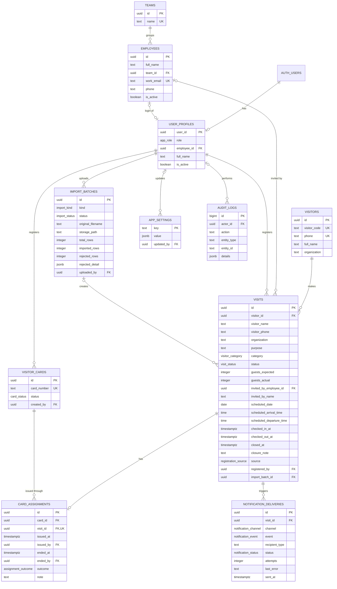

# 03. Database Design

Part of the [Development PRD](DEVELOPMENT_PRD.md). This is the owning document for the schema.

**This is a specification, not a migration.** Nothing here has been applied to Supabase. A migration plan needs separate approval (Phase 0 and Phase 1).

## Validation status

The DDL below was loaded into a throwaway local PostgreSQL 18 instance with stand-ins for Supabase's `auth` schema and roles, then stopped. A scripted run confirmed the role refusals and main state changes: employee and receptionist visibility, phone matching, delivery refusal, the Yes and No check-out paths, lost-card closure, no-shows, inactive users and anonymous access.

Not yet tested: real Supabase, concurrent check-ins, and the Storage policies, which are shown separately for that reason.

**Changes on 2026-11-05 for the owner's OQ decisions.** The updated DDL was loaded into a throwaway local PostgreSQL 16 instance with the same stand-ins, and these cases were checked: international phone refused; second active visit on one phone refused, including for an employee and while checked in; new visit allowed after check-out; check-in writes only the HR/Admin delivery row; card number correction keeps history and writes an audit row; duplicate and Receptionist card edits refused; Visitor ID set once and only by HR/Admin; deactivation keeps visits, queues an HR/Admin notice per upcoming visit and blocks the host for new visits; employee notification rows refused. The earlier full scripted run hasn't been repeated against this version.

## Entity relationships



## Design rules

| Topic | Rule |
|---|---|
| Keys | `uuid` with `gen_random_uuid()`, except `app_settings.key` and `audit_logs.id` |
| Time | `timestamptz` for moments. `scheduled_date` is a `date` and times are `time`, in the organization's time zone. |
| Deletes | Foreign keys use `RESTRICT`. Visits and card history can't be deleted. Employees and users go inactive, and cards are retired. |
| Soft delete | No generic `deleted_at`; `is_active` and status columns cover each case |
| Writes | Users can't write `visits`, `visitors` or `card_assignments` directly. Functions check roles and run in one transaction. |
| Visit snapshot | `visits` keeps the name, phone and organization as entered, so history shows who actually came (DEC-Q6) |
| Visitor record | `visitors.full_name` holds the latest name (Proposal) |
| One card per visit | `card_assignments.visit_id` is unique (DEC-Q3) |
| One visit per card | Partial unique index on open assignments |
| Assignment end | `ended_at` with `outcome`, so a lost card never reads as returned (DEC-Q4). "Returned date" in the PRD is `ended_at` where `outcome = 'returned'`. |
| Closed: card lost | Label for `closed_card_lost`, used for lost and damaged outcomes alike |
| Authentication | No auth method is stored here. Google and password identities live in Supabase Auth. No trigger creates a profile. |
| Visitor ID (OQ-1) | `visitors.visitor_code`, set by HR/Admin through `assign_visitor_code`, once. Unique when set. Never generated automatically. |
| Visitor ID is not a card | Cards are reusable: `visitor_cards` and `card_assignments` record which card each visit held, while the Visitor ID stays with the person. |
| Phone format (OQ-5) | Visitor phones must match `^\+8801[3-9][0-9]{8}$`. The server normalizes input before calling functions. |
| One active visit per phone (OQ-10) | Partial unique index on `visits (visitor_id)` where `status in ('expected', 'checked_in')`. Same phone means same visitor (DEC-Q6), so this covers the phone. |
| Card number correction (OQ-7) | `update_card_number` changes the number in place. History refers to `card_id`, so it isn't affected, and the old and new numbers go in the audit log. |
| Host deactivation (OQ-8) | `deactivate_employee` keeps every visit, writes an HR/Admin notification for each upcoming `expected` visit, and the host can no longer be chosen for new visits. |
| Notifications (OQ-3) | HR/Admin is the only recipient. |

## Schema

```sql
-- ---------------------------------------------------------------------------
-- Types
-- ---------------------------------------------------------------------------
create type public.app_role as enum ('hr_admin', 'receptionist', 'employee');
create type public.visitor_category as enum (
  'business_meeting', 'job_interview', 'vip_visit', 'vendor_supplier',
  'maintenance_technician', 'personal_guest', 'delivery_courier', 'other');
create type public.visit_status as enum (
  'expected', 'checked_in', 'checked_out', 'closed_card_lost',
  'no_show', 'cancelled', 'not_permitted');
create type public.card_status as enum ('available', 'issued', 'lost', 'damaged', 'retired');
create type public.assignment_outcome as enum ('returned', 'lost', 'damaged');
create type public.registration_source as enum ('hr_admin', 'employee', 'receptionist', 'import');
create type public.import_kind as enum ('candidates', 'cards');
create type public.import_status as enum ('processing', 'completed', 'failed');
create type public.notification_channel as enum ('telegram', 'whatsapp', 'slack');
create type public.notification_status as enum ('pending', 'sent', 'failed');
create type public.notification_event as enum ('visit_checked_in', 'host_deactivated');

-- ---------------------------------------------------------------------------
-- Tables
-- ---------------------------------------------------------------------------
create table public.teams (
  id          uuid primary key default gen_random_uuid(),
  name        text not null check (length(trim(name)) > 0),
  created_at  timestamptz not null default now(),
  updated_at  timestamptz not null default now()
);
create unique index teams_name_unique on public.teams (lower(trim(name)));

create table public.employees (
  id          uuid primary key default gen_random_uuid(),
  full_name   text not null check (length(trim(full_name)) > 0),
  team_id     uuid not null references public.teams (id) on delete restrict,
  work_email  text not null check (work_email ~ '^[^@\s]+@[^@\s]+\.[^@\s]+$'),  -- company domain checked on the server (OQ-12)
  phone       text check (phone is null or phone ~ '^\+[1-9][0-9]{7,14}$'),  -- optional (OQ-6)
  is_active   boolean not null default true,
  created_at  timestamptz not null default now(),
  updated_at  timestamptz not null default now()
);
create unique index employees_email_unique on public.employees (lower(work_email));
create index employees_name_search on public.employees (lower(full_name));
create index employees_team on public.employees (team_id);

create table public.user_profiles (
  user_id           uuid primary key references auth.users (id) on delete restrict,
  role              public.app_role not null,
  employee_id       uuid unique references public.employees (id) on delete restrict,
  full_name         text not null check (length(trim(full_name)) > 0),
  is_active         boolean not null default true,
  created_at        timestamptz not null default now(),
  updated_at        timestamptz not null default now(),
  constraint employee_role_needs_directory_entry
    check (role <> 'employee' or employee_id is not null)
);

create table public.visitors (
  id            uuid primary key default gen_random_uuid(),
  visitor_code  text unique check (visitor_code is null or length(trim(visitor_code)) > 0),
                -- Visitor ID: assigned by HR/Admin once (OQ-1). Not a card number.
  phone         text not null unique check (phone ~ '^\+8801[3-9][0-9]{8}$'),  -- Bangladesh only (OQ-5)
  full_name     text not null check (length(trim(full_name)) > 0),
  organization  text,
  created_at    timestamptz not null default now(),
  updated_at    timestamptz not null default now()
);

create table public.import_batches (
  id                 uuid primary key default gen_random_uuid(),
  kind               public.import_kind not null,
  status             public.import_status not null default 'processing',
  original_filename  text not null,
  storage_path       text,
  total_rows         integer not null default 0 check (total_rows >= 0),
  imported_rows      integer not null default 0 check (imported_rows >= 0),
  rejected_rows      integer not null default 0 check (rejected_rows >= 0),
  rejected_detail    jsonb not null default '[]'::jsonb,
  uploaded_by        uuid not null references public.user_profiles (user_id) on delete restrict,
  created_at         timestamptz not null default now(),
  completed_at       timestamptz
);

create table public.visits (
  id                        uuid primary key default gen_random_uuid(),
  visitor_id                uuid not null references public.visitors (id) on delete restrict,
  visitor_name              text not null check (length(trim(visitor_name)) > 0),
  visitor_phone             text not null check (visitor_phone ~ '^\+8801[3-9][0-9]{8}$'),
  organization              text,
  purpose                   text not null check (length(trim(purpose)) > 0),
  category                  public.visitor_category not null,
  status                    public.visit_status not null default 'expected',
  guests_expected           integer not null default 0 check (guests_expected >= 0),
  guests_actual             integer check (guests_actual is null or guests_actual >= 0),
  invited_by_employee_id    uuid references public.employees (id) on delete restrict,
  invited_by_name           text,
  scheduled_date            date not null,
  scheduled_arrival_time    time,
  scheduled_departure_time  time,
  checked_in_at             timestamptz,
  checked_in_by             uuid references public.user_profiles (user_id) on delete restrict,
  checked_out_at            timestamptz,
  checked_out_by            uuid references public.user_profiles (user_id) on delete restrict,
  closed_at                 timestamptz,
  closed_by                 uuid references public.user_profiles (user_id) on delete restrict,
  closure_note              text,
  source                    public.registration_source not null,
  registered_by             uuid not null references public.user_profiles (user_id) on delete restrict,
  import_batch_id           uuid references public.import_batches (id) on delete restrict,
  created_at                timestamptz not null default now(),
  updated_at                timestamptz not null default now(),
  constraint delivery_is_never_admitted
    check ((category = 'delivery_courier') = (status = 'not_permitted')),
  constraint admitted_needs_invited_by
    check (status not in ('checked_in', 'checked_out', 'closed_card_lost')
           or invited_by_employee_id is not null
           or length(trim(coalesce(invited_by_name, ''))) > 0),
  constraint check_in_time_matches_status
    check ((status in ('checked_in', 'checked_out', 'closed_card_lost')) = (checked_in_at is not null)),
  constraint check_out_time_matches_status
    check ((status = 'checked_out') = (checked_out_at is not null)),
  constraint check_out_after_check_in
    check (checked_out_at is null or checked_out_at >= checked_in_at),
  constraint lost_card_closure_has_note
    check (status <> 'closed_card_lost'
           or (closed_at is not null and closed_by is not null
               and length(trim(coalesce(closure_note, ''))) > 0))
);
create index visits_status_date on public.visits (status, scheduled_date);
create index visits_scheduled_date on public.visits (scheduled_date);
create index visits_checked_in_at on public.visits (checked_in_at);
create index visits_visitor on public.visits (visitor_id);
create index visits_invited_by on public.visits (invited_by_employee_id);
create index visits_registered_by on public.visits (registered_by);
create unique index visits_import_no_duplicate
  on public.visits (visitor_id, scheduled_date) where import_batch_id is not null;
-- One active visit per phone (OQ-10). Raised to users as visitor_has_active_visit.
create unique index visits_one_active_per_visitor
  on public.visits (visitor_id) where status in ('expected', 'checked_in');

create table public.visitor_cards (
  id           uuid primary key default gen_random_uuid(),
  card_number  text not null check (length(trim(card_number)) > 0),
  status       public.card_status not null default 'available',
  created_by   uuid not null references public.user_profiles (user_id) on delete restrict,
  created_at   timestamptz not null default now(),
  updated_at   timestamptz not null default now()
);
create unique index visitor_cards_number_unique on public.visitor_cards (upper(trim(card_number)));
create index visitor_cards_status on public.visitor_cards (status);

create table public.card_assignments (
  id         uuid primary key default gen_random_uuid(),
  card_id    uuid not null references public.visitor_cards (id) on delete restrict,
  visit_id   uuid not null unique references public.visits (id) on delete restrict,
  issued_at  timestamptz not null default now(),
  issued_by  uuid not null references public.user_profiles (user_id) on delete restrict,
  ended_at   timestamptz,
  ended_by   uuid references public.user_profiles (user_id) on delete restrict,
  outcome    public.assignment_outcome,
  note       text,
  constraint end_fields_together
    check ((ended_at is null) = (outcome is null) and (ended_at is null) = (ended_by is null)),
  constraint ended_after_issued
    check (ended_at is null or ended_at >= issued_at),
  constraint loss_needs_note
    check (outcome is null or outcome = 'returned' or length(trim(coalesce(note, ''))) > 0)
);
create unique index one_open_assignment_per_card
  on public.card_assignments (card_id) where ended_at is null;
create index card_assignments_issued_at on public.card_assignments (issued_at);

create table public.notification_deliveries (
  id              uuid primary key default gen_random_uuid(),
  visit_id        uuid not null references public.visits (id) on delete restrict,
  channel         public.notification_channel not null,
  event           public.notification_event not null default 'visit_checked_in',
  recipient_type  text not null default 'hr_admin' check (recipient_type = 'hr_admin'),  -- OQ-3
  status          public.notification_status not null default 'pending',
  attempts        integer not null default 0 check (attempts >= 0),
  last_error      text,
  sent_at         timestamptz,
  created_at      timestamptz not null default now(),
  updated_at      timestamptz not null default now()
);
create unique index notification_once_per_event
  on public.notification_deliveries (visit_id, channel, recipient_type, event);
create index notification_pending on public.notification_deliveries (status) where status <> 'sent';

create table public.app_settings (
  key         text primary key,
  value       jsonb not null,
  updated_by  uuid references public.user_profiles (user_id) on delete restrict,
  updated_at  timestamptz not null default now()
);
insert into public.app_settings (key, value) values
  ('organization_name', 'null'::jsonb),
  ('time_zone', '"Asia/Dhaka"'::jsonb),
  ('notification_channel', '"telegram"'::jsonb),
  ('hr_telegram_chat_id', 'null'::jsonb);

create table public.audit_logs (
  id           bigint generated always as identity primary key,
  actor_id     uuid references public.user_profiles (user_id) on delete restrict,
  action       text not null,
  entity_type  text not null,
  entity_id    text not null,
  details      jsonb not null default '{}'::jsonb,
  created_at   timestamptz not null default now()
);
create index audit_logs_entity on public.audit_logs (entity_type, entity_id);
create index audit_logs_created_at on public.audit_logs (created_at);

-- ---------------------------------------------------------------------------
-- Helpers
-- ---------------------------------------------------------------------------
create function public.set_updated_at() returns trigger
language plpgsql set search_path = '' as $$
begin
  new.updated_at := now();
  return new;
end $$;

create trigger teams_updated before update on public.teams
  for each row execute function public.set_updated_at();
create trigger employees_updated before update on public.employees
  for each row execute function public.set_updated_at();
create trigger user_profiles_updated before update on public.user_profiles
  for each row execute function public.set_updated_at();
create trigger visitors_updated before update on public.visitors
  for each row execute function public.set_updated_at();
create trigger visits_updated before update on public.visits
  for each row execute function public.set_updated_at();
create trigger visitor_cards_updated before update on public.visitor_cards
  for each row execute function public.set_updated_at();
create trigger notification_deliveries_updated before update on public.notification_deliveries
  for each row execute function public.set_updated_at();

-- Role of the signed-in user. NULL when the account is missing or inactive.
create function public.auth_role() returns public.app_role
language sql stable security definer set search_path = '' as $$
  select role from public.user_profiles
  where user_id = auth.uid() and is_active
$$;

create function public.auth_employee_id() returns uuid
language sql stable security definer set search_path = '' as $$
  select employee_id from public.user_profiles
  where user_id = auth.uid() and is_active
$$;

create function public.org_today() returns date
language sql stable security definer set search_path = '' as $$
  select (now() at time zone coalesce(
    (select value #>> '{}' from public.app_settings where key = 'time_zone'),
    'Asia/Dhaka'))::date
$$;

create function public.require_role(variadic allowed public.app_role[]) returns public.app_role
language plpgsql stable security definer set search_path = '' as $$
declare r public.app_role := public.auth_role();
begin
  if r is null or not (r = any (allowed)) then
    raise exception 'not_authorized' using errcode = '42501';
  end if;
  return r;
end $$;

-- ---------------------------------------------------------------------------
-- Operations. All visit and card state changes go through these functions.
-- ---------------------------------------------------------------------------
create function public.register_visit(
  p_full_name text, p_phone text, p_purpose text, p_category public.visitor_category,
  p_organization text default null, p_guests_expected integer default 0,
  p_invited_by_employee_id uuid default null, p_invited_by_name text default null,
  p_scheduled_date date default null, p_arrival_time time default null,
  p_departure_time time default null, p_import_batch_id uuid default null
) returns uuid
language plpgsql security definer set search_path = '' as $$
declare
  r public.app_role := public.require_role('hr_admin', 'receptionist', 'employee');
  v_visitor uuid;
  v_visit uuid;
  v_source public.registration_source;
  v_invited uuid := p_invited_by_employee_id;
  v_invited_name text := nullif(trim(coalesce(p_invited_by_name, '')), '');
  v_date date := coalesce(p_scheduled_date, public.org_today());
begin
  if p_category = 'delivery_courier' and r <> 'receptionist' then
    raise exception 'delivery_receptionist_only' using errcode = '42501';
  end if;
  if p_import_batch_id is not null and r <> 'hr_admin' then
    raise exception 'not_authorized' using errcode = '42501';
  end if;

  if r = 'employee' then
    v_invited := public.auth_employee_id();
    v_invited_name := null;
    v_source := 'employee';
  elsif r = 'receptionist' then
    v_date := public.org_today();
    v_source := 'receptionist';
  elsif p_import_batch_id is not null then
    v_source := 'import';
  else
    v_source := 'hr_admin';
  end if;

  -- A deactivated employee can't be chosen as host for a new visit (OQ-8).
  if v_invited is not null and not exists (
       select 1 from public.employees where id = v_invited and is_active) then
    raise exception 'host_inactive' using errcode = 'P0001';
  end if;

  insert into public.visitors (phone, full_name, organization)
  values (p_phone, trim(p_full_name), nullif(trim(coalesce(p_organization, '')), ''))
  on conflict (phone) do update
    set full_name = excluded.full_name,
        organization = coalesce(excluded.organization, public.visitors.organization)
  returning id into v_visitor;

  -- One active visit per phone (OQ-10). The message shown says nothing about the existing visit.
  if p_category <> 'delivery_courier' and exists (
       select 1 from public.visits
       where visitor_id = v_visitor and status in ('expected', 'checked_in')) then
    raise exception 'visitor_has_active_visit' using errcode = 'P0001';
  end if;

  insert into public.visits (
    visitor_id, visitor_name, visitor_phone, organization, purpose, category, status,
    guests_expected, invited_by_employee_id, invited_by_name, scheduled_date,
    scheduled_arrival_time, scheduled_departure_time, source, registered_by, import_batch_id)
  values (
    v_visitor, trim(p_full_name), p_phone, nullif(trim(coalesce(p_organization, '')), ''),
    trim(p_purpose), p_category,
    case when p_category = 'delivery_courier' then 'not_permitted'::public.visit_status
         else 'expected'::public.visit_status end,
    coalesce(p_guests_expected, 0), v_invited, v_invited_name, v_date,
    p_arrival_time, p_departure_time, v_source, auth.uid(), p_import_batch_id)
  returning id into v_visit;

  return v_visit;
end $$;

create function public.update_visit_details(
  p_visit_id uuid, p_full_name text, p_phone text, p_purpose text,
  p_category public.visitor_category, p_organization text, p_guests_expected integer,
  p_invited_by_employee_id uuid, p_invited_by_name text, p_scheduled_date date,
  p_arrival_time time, p_departure_time time
) returns void
language plpgsql security definer set search_path = '' as $$
declare
  r public.app_role := public.require_role('hr_admin', 'receptionist', 'employee');
  v public.visits;
  v_visitor uuid;
begin
  select * into v from public.visits where id = p_visit_id for update;
  if not found then raise exception 'visit_not_found' using errcode = 'P0002'; end if;
  if v.status <> 'expected' then raise exception 'visit_not_editable' using errcode = 'P0001'; end if;
  if p_category = 'delivery_courier' then raise exception 'delivery_not_allowed' using errcode = 'P0001'; end if;
  if r = 'employee' and not (v.registered_by = auth.uid()
       or v.invited_by_employee_id = public.auth_employee_id()) then
    raise exception 'not_authorized' using errcode = '42501';
  end if;
  if r <> 'employee' and p_invited_by_employee_id is not null
     and p_invited_by_employee_id is distinct from v.invited_by_employee_id
     and not exists (select 1 from public.employees
                     where id = p_invited_by_employee_id and is_active) then
    raise exception 'host_inactive' using errcode = 'P0001';
  end if;

  insert into public.visitors (phone, full_name, organization)
  values (p_phone, trim(p_full_name), nullif(trim(coalesce(p_organization, '')), ''))
  on conflict (phone) do update
    set full_name = excluded.full_name,
        organization = coalesce(excluded.organization, public.visitors.organization)
  returning id into v_visitor;

  if v_visitor <> v.visitor_id and exists (
       select 1 from public.visits
       where visitor_id = v_visitor and status in ('expected', 'checked_in')) then
    raise exception 'visitor_has_active_visit' using errcode = 'P0001';
  end if;

  update public.visits set
    visitor_id = v_visitor, visitor_name = trim(p_full_name), visitor_phone = p_phone,
    organization = nullif(trim(coalesce(p_organization, '')), ''), purpose = trim(p_purpose),
    category = p_category, guests_expected = coalesce(p_guests_expected, 0),
    invited_by_employee_id = case when r = 'employee' then v.invited_by_employee_id else p_invited_by_employee_id end,
    invited_by_name = case when r = 'employee' then v.invited_by_name else nullif(trim(coalesce(p_invited_by_name, '')), '') end,
    scheduled_date = p_scheduled_date, scheduled_arrival_time = p_arrival_time,
    scheduled_departure_time = p_departure_time
  where id = p_visit_id;
end $$;

create function public.cancel_visit(p_visit_id uuid, p_note text default null) returns void
language plpgsql security definer set search_path = '' as $$
declare
  r public.app_role := public.require_role('hr_admin', 'employee');
  v public.visits;
begin
  select * into v from public.visits where id = p_visit_id for update;
  if not found then raise exception 'visit_not_found' using errcode = 'P0002'; end if;
  if v.status <> 'expected' then raise exception 'visit_not_cancellable' using errcode = 'P0001'; end if;
  if r = 'employee' and not (v.registered_by = auth.uid()
       or v.invited_by_employee_id = public.auth_employee_id()) then
    raise exception 'not_authorized' using errcode = '42501';
  end if;
  update public.visits
    set status = 'cancelled', closed_at = now(), closed_by = auth.uid(), closure_note = p_note
  where id = p_visit_id;
end $$;

create function public.check_in_visit(
  p_visit_id uuid, p_card_id uuid, p_guests_actual integer default null
) returns void
language plpgsql security definer set search_path = '' as $$
declare
  v public.visits;
  c public.visitor_cards;
begin
  perform public.require_role('receptionist');

  select * into v from public.visits where id = p_visit_id for update;
  if not found then raise exception 'visit_not_found' using errcode = 'P0002'; end if;
  if v.category = 'delivery_courier' then
    raise exception 'delivery_not_permitted' using errcode = 'P0001';
  end if;
  if v.status <> 'expected' then raise exception 'visit_not_expected' using errcode = 'P0001'; end if;
  if v.invited_by_employee_id is null and length(trim(coalesce(v.invited_by_name, ''))) = 0 then
    raise exception 'invited_by_required' using errcode = 'P0001';
  end if;

  select * into c from public.visitor_cards where id = p_card_id for update;
  if not found then raise exception 'card_not_found' using errcode = 'P0002'; end if;
  if c.status <> 'available' then raise exception 'card_not_available' using errcode = 'P0001'; end if;

  insert into public.card_assignments (card_id, visit_id, issued_by)
  values (p_card_id, p_visit_id, auth.uid());
  update public.visitor_cards set status = 'issued' where id = p_card_id;
  update public.visits
    set status = 'checked_in', checked_in_at = now(), checked_in_by = auth.uid(),
        guests_actual = coalesce(p_guests_actual, guests_actual)
  where id = p_visit_id;

  -- HR/Admin is the only recipient, in every workflow (OQ-3).
  insert into public.notification_deliveries (visit_id, channel, recipient_type, event)
  values (p_visit_id, 'telegram', 'hr_admin', 'visit_checked_in');
end $$;

-- Returns true when the check-out completed. "No" changes nothing and returns false.
create function public.check_out_visit(p_visit_id uuid, p_card_returned boolean) returns boolean
language plpgsql security definer set search_path = '' as $$
declare
  v public.visits;
  a public.card_assignments;
begin
  perform public.require_role('receptionist');

  select * into v from public.visits where id = p_visit_id for update;
  if not found then raise exception 'visit_not_found' using errcode = 'P0002'; end if;
  if v.status <> 'checked_in' then raise exception 'visit_not_checked_in' using errcode = 'P0001'; end if;
  if not p_card_returned then return false; end if;

  select * into a from public.card_assignments where visit_id = p_visit_id and ended_at is null for update;
  update public.card_assignments
    set ended_at = now(), ended_by = auth.uid(), outcome = 'returned' where id = a.id;
  update public.visitor_cards set status = 'available' where id = a.card_id;
  update public.visits
    set status = 'checked_out', checked_out_at = now(), checked_out_by = auth.uid()
  where id = p_visit_id;
  return true;
end $$;

create function public.resolve_lost_card(
  p_visit_id uuid, p_outcome public.assignment_outcome, p_note text
) returns void
language plpgsql security definer set search_path = '' as $$
declare
  v public.visits;
  a public.card_assignments;
begin
  perform public.require_role('hr_admin');
  if p_outcome = 'returned' then raise exception 'invalid_outcome' using errcode = 'P0001'; end if;
  if length(trim(coalesce(p_note, ''))) = 0 then raise exception 'note_required' using errcode = 'P0001'; end if;

  select * into v from public.visits where id = p_visit_id for update;
  if not found then raise exception 'visit_not_found' using errcode = 'P0002'; end if;
  if v.status <> 'checked_in' then raise exception 'visit_not_checked_in' using errcode = 'P0001'; end if;

  select * into a from public.card_assignments where visit_id = p_visit_id and ended_at is null for update;
  update public.card_assignments
    set ended_at = now(), ended_by = auth.uid(), outcome = p_outcome, note = p_note where id = a.id;
  update public.visitor_cards
    set status = case when p_outcome = 'lost' then 'lost'::public.card_status
                      else 'damaged'::public.card_status end
  where id = a.card_id;
  update public.visits
    set status = 'closed_card_lost', closed_at = now(), closed_by = auth.uid(), closure_note = p_note
  where id = p_visit_id;
  insert into public.audit_logs (actor_id, action, entity_type, entity_id, details)
  values (auth.uid(), 'card.' || p_outcome::text, 'visit', p_visit_id::text,
          jsonb_build_object('card_id', a.card_id, 'note', p_note));
end $$;

create function public.retire_card(p_card_id uuid, p_note text default null) returns void
language plpgsql security definer set search_path = '' as $$
begin
  perform public.require_role('hr_admin');
  update public.visitor_cards set status = 'retired' where id = p_card_id and status = 'available';
  if not found then raise exception 'card_not_retirable' using errcode = 'P0001'; end if;
  insert into public.audit_logs (actor_id, action, entity_type, entity_id, details)
  values (auth.uid(), 'card.retired', 'visitor_card', p_card_id::text, jsonb_build_object('note', p_note));
end $$;

-- Corrects a wrongly entered card number (OQ-7). History refers to card_id, so it is kept.
create function public.update_card_number(p_card_id uuid, p_card_number text) returns void
language plpgsql security definer set search_path = '' as $$
declare
  c public.visitor_cards;
  v_new text := trim(coalesce(p_card_number, ''));
begin
  perform public.require_role('hr_admin');
  if length(v_new) = 0 then raise exception 'card_number_required' using errcode = 'P0001'; end if;
  select * into c from public.visitor_cards where id = p_card_id for update;
  if not found then raise exception 'card_not_found' using errcode = 'P0002'; end if;
  -- visitor_cards_number_unique rejects a duplicate; raised to users as card_number_exists.
  update public.visitor_cards set card_number = v_new where id = p_card_id;
  insert into public.audit_logs (actor_id, action, entity_type, entity_id, details)
  values (auth.uid(), 'card.number_changed', 'visitor_card', p_card_id::text,
          jsonb_build_object('from', c.card_number, 'to', v_new));
end $$;

-- HR/Admin assigns a visitor's permanent Visitor ID, once (OQ-1). Not a card number.
create function public.assign_visitor_code(p_visitor_id uuid, p_code text) returns void
language plpgsql security definer set search_path = '' as $$
declare
  vi public.visitors;
  v_code text := trim(coalesce(p_code, ''));
begin
  perform public.require_role('hr_admin');
  if length(v_code) = 0 then raise exception 'visitor_code_required' using errcode = 'P0001'; end if;
  select * into vi from public.visitors where id = p_visitor_id for update;
  if not found then raise exception 'visitor_not_found' using errcode = 'P0002'; end if;
  if vi.visitor_code is not null then
    raise exception 'visitor_code_already_set' using errcode = 'P0001';
  end if;
  -- The unique constraint rejects an ID already in use; raised to users as visitor_code_exists.
  update public.visitors set visitor_code = v_code where id = p_visitor_id;
end $$;

-- Deactivates an employee and their login (OQ-8). Visits are kept. Returns the upcoming
-- expected visits that name them, and queues an HR/Admin notification for each one.
-- The server then bans the Auth user with the service role.
create function public.deactivate_employee(p_employee_id uuid) returns setof uuid
language plpgsql security definer set search_path = '' as $$
begin
  perform public.require_role('hr_admin');
  update public.employees set is_active = false where id = p_employee_id and is_active;
  if not found then raise exception 'employee_not_active' using errcode = 'P0001'; end if;
  update public.user_profiles set is_active = false where employee_id = p_employee_id;

  insert into public.notification_deliveries (visit_id, channel, recipient_type, event)
  select id, 'telegram', 'hr_admin', 'host_deactivated'
  from public.visits
  where invited_by_employee_id = p_employee_id
    and status = 'expected' and scheduled_date >= public.org_today()
  on conflict do nothing;

  insert into public.audit_logs (actor_id, action, entity_type, entity_id, details)
  values (auth.uid(), 'employee.deactivated', 'employee', p_employee_id::text, '{}'::jsonb);

  return query
    select id from public.visits
    where invited_by_employee_id = p_employee_id
      and status = 'expected' and scheduled_date >= public.org_today();
end $$;

-- Receptionists and HR/Admin only. Returns name and team, nothing private.
create function public.search_hosts(p_query text)
returns table (employee_id uuid, full_name text, team_name text)
language plpgsql stable security definer set search_path = '' as $$
begin
  perform public.require_role('hr_admin', 'receptionist');
  return query
    select e.id, e.full_name, t.name
    from public.employees e join public.teams t on t.id = e.team_id
    where e.is_active
      and (lower(e.full_name) like '%' || lower(trim(p_query)) || '%'
           or lower(t.name) like '%' || lower(trim(p_query)) || '%')
    order by e.full_name
    limit 20;
end $$;

-- Runs from the scheduled job under the service role.
create function public.mark_no_shows() returns integer
language plpgsql security definer set search_path = '' as $$
declare n integer;
begin
  update public.visits set status = 'no_show'
  where status = 'expected' and scheduled_date < public.org_today();
  get diagnostics n = row_count;
  return n;
end $$;

-- ---------------------------------------------------------------------------
-- Row Level Security
-- ---------------------------------------------------------------------------
alter table public.teams enable row level security;
alter table public.employees enable row level security;
alter table public.user_profiles enable row level security;
alter table public.visitors enable row level security;
alter table public.import_batches enable row level security;
alter table public.visits enable row level security;
alter table public.visitor_cards enable row level security;
alter table public.card_assignments enable row level security;
alter table public.notification_deliveries enable row level security;
alter table public.app_settings enable row level security;
alter table public.audit_logs enable row level security;

create policy teams_hr_all on public.teams for all to authenticated
  using (public.auth_role() = 'hr_admin') with check (public.auth_role() = 'hr_admin');

create policy employees_hr_all on public.employees for all to authenticated
  using (public.auth_role() = 'hr_admin') with check (public.auth_role() = 'hr_admin');
create policy employees_self_read on public.employees for select to authenticated
  using (id = public.auth_employee_id());

create policy profiles_self_read on public.user_profiles for select to authenticated
  using (user_id = auth.uid());
create policy profiles_hr_read on public.user_profiles for select to authenticated
  using (public.auth_role() = 'hr_admin');

create policy visitors_staff_read on public.visitors for select to authenticated
  using (public.auth_role() in ('hr_admin', 'receptionist'));

create policy imports_hr_read on public.import_batches for select to authenticated
  using (public.auth_role() = 'hr_admin');
create policy imports_hr_insert on public.import_batches for insert to authenticated
  with check (public.auth_role() = 'hr_admin' and uploaded_by = auth.uid());
create policy imports_hr_update on public.import_batches for update to authenticated
  using (public.auth_role() = 'hr_admin') with check (public.auth_role() = 'hr_admin');

create policy visits_hr_read on public.visits for select to authenticated
  using (public.auth_role() = 'hr_admin');
create policy visits_reception_read on public.visits for select to authenticated
  using (public.auth_role() = 'receptionist'
         and (status = 'checked_in'
              or status = 'expected'
              or scheduled_date = public.org_today()));
create policy visits_employee_read on public.visits for select to authenticated
  using (public.auth_role() = 'employee'
         and (registered_by = auth.uid()
              or invited_by_employee_id = public.auth_employee_id()));

create policy cards_staff_read on public.visitor_cards for select to authenticated
  using (public.auth_role() in ('hr_admin', 'receptionist'));
create policy cards_hr_insert on public.visitor_cards for insert to authenticated
  with check (public.auth_role() = 'hr_admin' and status = 'available' and created_by = auth.uid());

create policy assignments_hr_read on public.card_assignments for select to authenticated
  using (public.auth_role() = 'hr_admin');
create policy assignments_reception_read on public.card_assignments for select to authenticated
  using (public.auth_role() = 'receptionist'
         and exists (select 1 from public.visits v where v.id = visit_id));

create policy deliveries_hr_read on public.notification_deliveries for select to authenticated
  using (public.auth_role() = 'hr_admin');
create policy deliveries_reception_read on public.notification_deliveries for select to authenticated
  using (public.auth_role() = 'receptionist'
         and exists (select 1 from public.visits v where v.id = visit_id));

create policy settings_hr_read on public.app_settings for select to authenticated
  using (public.auth_role() = 'hr_admin');
create policy settings_hr_update on public.app_settings for update to authenticated
  using (public.auth_role() = 'hr_admin')
  with check (public.auth_role() = 'hr_admin' and updated_by = auth.uid());

create policy audit_hr_read on public.audit_logs for select to authenticated
  using (public.auth_role() = 'hr_admin');

-- ---------------------------------------------------------------------------
-- Grants. Nothing is reachable without a grant here, and anon gets nothing.
-- ---------------------------------------------------------------------------
revoke all on all tables in schema public from public, anon, authenticated;
revoke all on all functions in schema public from public, anon, authenticated;

grant select on public.teams, public.employees, public.user_profiles, public.visitors,
  public.import_batches, public.visits, public.visitor_cards, public.card_assignments,
  public.notification_deliveries, public.app_settings, public.audit_logs to authenticated;
grant insert, update, delete on public.teams to authenticated;
grant insert, update on public.employees to authenticated;
grant insert, update on public.import_batches to authenticated;
grant insert on public.visitor_cards to authenticated;
grant update (value, updated_by) on public.app_settings to authenticated;

grant execute on function public.auth_role(), public.auth_employee_id(), public.org_today()
  to authenticated;
grant execute on function
  public.register_visit(text, text, text, public.visitor_category, text, integer, uuid, text, date, time, time, uuid),
  public.update_visit_details(uuid, text, text, text, public.visitor_category, text, integer, uuid, text, date, time, time),
  public.cancel_visit(uuid, text),
  public.check_in_visit(uuid, uuid, integer),
  public.check_out_visit(uuid, boolean),
  public.resolve_lost_card(uuid, public.assignment_outcome, text),
  public.retire_card(uuid, text),
  public.update_card_number(uuid, text),
  public.assign_visitor_code(uuid, text),
  public.deactivate_employee(uuid),
  public.search_hosts(text)
  to authenticated;
grant execute on function public.mark_no_shows() to service_role;

-- ---------------------------------------------------------------------------
-- Realtime. Subscribers receive only rows that RLS lets them read.
-- ---------------------------------------------------------------------------
alter publication supabase_realtime add table public.visits, public.visitor_cards;
```

## Storage

A private bucket named `imports`, with paths such as `candidates/<batch_id>.xlsx`. Files are never public.

```sql
insert into storage.buckets (id, name, public) values ('imports', 'imports', false);

create policy imports_hr_read on storage.objects for select to authenticated
  using (bucket_id = 'imports' and public.auth_role() = 'hr_admin');
create policy imports_hr_write on storage.objects for insert to authenticated
  with check (bucket_id = 'imports' and public.auth_role() = 'hr_admin');
```

## Account creation

Profile rows are inserted only by server-only code using the service role, during `inviteUser`. `authenticated` has no insert or update grant on `user_profiles`, so nobody can change their own role, and a new Google sign-in can't create a profile.

## Decisions affecting this schema

See [Development PRD §14](DEVELOPMENT_PRD.md#14-open-questions-and-decisions). All of these were decided on 2026-11-05:

| Decision | Where it shows in this schema |
|---|---|
| OQ-1 Visitor ID | `visitors.visitor_code`, `assign_visitor_code` |
| OQ-3, OQ-4 HR/Admin-only notifications | `notification_deliveries.recipient_type`; no `employee_id` or `telegram_chat_id` |
| OQ-5 Bangladeshi phones | Phone checks on `visitors` and `visits` |
| OQ-6 Employee phone optional | `employees.phone` nullable |
| OQ-7 Card number correction | `update_card_number` |
| OQ-8 Host deactivation | `deactivate_employee`, `host_inactive` checks, event `host_deactivated` |
| OQ-10 One active visit per phone | `visits_one_active_per_visitor`, `visitor_has_active_visit` |

Still open for this schema: the Visitor ID format and correction rule, and the employee phone format (Development PRD, "Details still needed").
