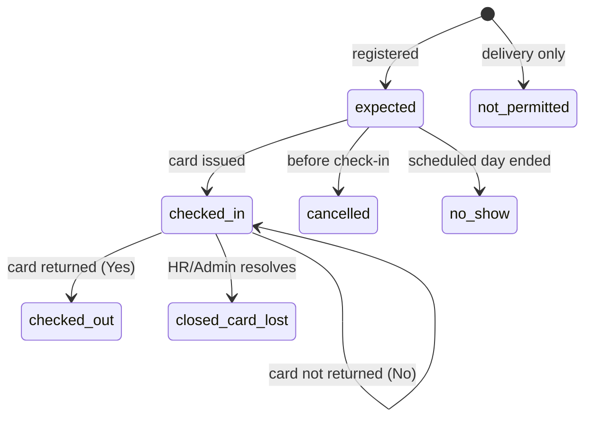
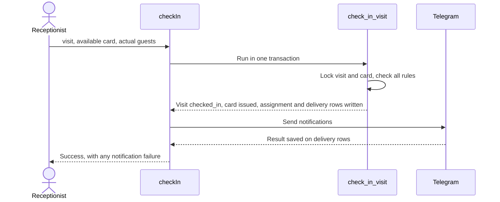

# 06. Business Workflows

Part of the [Development PRD](DEVELOPMENT_PRD.md). Business source: [Requirement PRD §5](../source/REQUIREMENT_PRD.md).

## Visit states

| Status | Label | Dashboard meaning |
|---|---|---|
| `expected` | Expected | Waiting to arrive |
| `checked_in` | Checked In | On site |
| `checked_out` | Checked Out | Counts as Completed (DEC-Q5) |
| `closed_card_lost` | Closed: card lost | Visit closed, card not returned |
| `no_show` | No-Show | Did not arrive |
| `cancelled` | Cancelled | Called off |
| `not_permitted` | Not permitted to enter | Delivery log; excluded from Total Visitors (DEC-Q16) |

**Active visits** are `expected` and `checked_in`. One phone number can have only one active visit at a time. Once a visit ends (checked out, closed, cancelled or no-show), the same number can be registered again (OQ-10).

**Dashboard period (OQ-2).** Total Visitors means today's visits, in the organization's time zone, excluding couriers. Dashboard counts and activity visuals use today unless another period is stated.

## Sign-in

Covered in [02](02-technical-architecture.md#google-sign-in-flow) and [04](04-user-roles-and-permissions.md#account-authorization).

## Standard check-in (all workflows)

**Start:** visit is `expected`. **Actor:** Receptionist. **Permission:** `visit.check_in`.

| Step | Rule | Failure |
|---|---|---|
| Visit | Must be `expected`, not delivery | `visit_not_expected`, `delivery_not_permitted` |
| Invited By | Filled in (DEC-Q7) | `invited_by_required` |
| Card | Must be `available` | `card_not_available`; refresh the list |
| No card available | Check-in blocked (DEC-Q14) | Receptionist contacts HR/Admin |
| Changes | Time recorded, card `issued`, assignment opened | Transaction rolls back as a whole |
| Notify | HR/Admin only, in every workflow (OQ-3) | Failure doesn't undo check-in; retry or manual fallback |

A visitor expected on a later date can still be checked in, because the PRD sets no restriction.

**Cards are reusable.** The card is linked to this visit only. After a confirmed return it is Available, and the Receptionist can issue it to the next visitor. The card number is never the visitor's ID.

## Standard check-out (all workflows)

**Start:** visit is `checked_in`. **Actor:** Receptionist. **Permission:** `visit.check_out`.

The popup text is exactly: **"Did you get the visitor card back?"**

| Answer | Result |
|---|---|
| Yes | Time recorded, visit `checked_out`, card `available`, assignment closed as `returned`, dashboard updates |
| No | Nothing changes. Visitor stays Checked In and the card stays assigned. |

## Lost or damaged card (DEC-Q4)

**Actor:** HR/Admin only. **Permission:** `card.resolve_loss`. **Input:** outcome and a required note.

**Result:** visit `closed_card_lost`, card `lost` or `damaged`, assignment closed with that outcome, audit row written. History doesn't show the card as returned, and the card can't be assigned again.

## Workflow A: HR/Admin pre-registers

| Item | Detail |
|---|---|
| Start and actor | Visit is planned; HR/Admin |
| Required | Name, phone (Bangladeshi), purpose, category, date |
| Permission | `visit.create` |
| Changes | Visitor matched or created; visit `expected`, source `hr_admin`. Refused if the phone already has an active visit. |
| Next | Appears in Expected Visitors. On arrival, a visual identity check (DEC-Q19), then standard check-in. |
| Notifications | HR/Admin at check-in |
| Exceptions | Invalid fields; phone already has an active visit; deactivated host; no-show; cancelled |

## Workflow B: Employee-initiated

| Item | Detail |
|---|---|
| Start and actor | Employee logs in and selects Add New Visitor |
| Required | Name, phone, purpose, category, date |
| Permission | `visit.create` (own) |
| Changes | Visit `expected`, source `employee`, Invited By set to the employee. No approval. |
| Next | Appears in Expected Visitors, dashboard and records; standard check-in |
| Notifications | HR/Admin at check-in. The employee isn't notified (OQ-3). **Differs from PRD §5B step 8.** |
| Exceptions | Phone already has an active visit; no-show; employee edits or cancels before check-in (DEC-Q10) |

**HR/Admin on an employee's behalf (DEC-Q2):** follows Workflow A, recording the inviting employee. That employee isn't notified (OQ-3).

## Workflow C: Unscheduled visitor

| Item | Detail |
|---|---|
| Start and actor | Visitor arrives unannounced; Receptionist |
| Required | Name, phone, purpose, category; Invited By before check-in |
| Permission | `visit.create`, `visit.check_in` |
| Changes | Visit `expected` for today, source `receptionist`, then standard check-in |
| Host search | `searchHosts`, name and team only |
| Host not found | Receptionist contacts HR/Admin and types the confirmed name in Invited By. No approval. The call isn't recorded (OQ-9). |
| Notifications | HR/Admin at check-in |
| Exceptions | Phone already has an active visit; no card available |

## Workflow D: Personal Guest

As Workflow C, with category `personal_guest`. History records the type.

## Workflow E: Interview Candidate

| Item | Detail |
|---|---|
| Start and actor | HR/Admin uploads the candidate template |
| Permission | `import.run` |
| Changes | File stored privately, batch row created, one `expected` visit per valid row with category `job_interview` and source `import` |
| Next | Candidates appear in Expected Visitors on their date; standard check-in |
| Notifications | HR/Admin at check-in |
| Exceptions | Bad rows listed with reasons; duplicates (same phone and date) and phones that already have an active visit rejected; non-Bangladeshi phones rejected; wrong or oversized file refused |

Card uploads follow the same steps with the card template.

## Workflow F: VIP visitors and groups

| Item | Detail |
|---|---|
| Start and actor | HR/Admin registers with the expected number of guests |
| Permission | `visit.create` |
| Changes | Visit `expected`, category `vip_visit`, `guests_expected` set |
| On arrival | Receptionist verifies the actual number; `guests_actual` saved at check-in |
| Cards | One card for the whole visit or group, for any visit type (DEC-Q3). The group checks in and out together. |
| Notifications | HR/Admin at check-in |
| Exceptions | Actual differs from expected: both are kept |

## Delivery personnel (DEC-Q8)

| Item | Detail |
|---|---|
| Actor | Receptionist, through `logDeliveryVisitor` |
| Required | Name, phone, purpose (PRD §4.1 applies to every visitor) |
| Changes | Visit `not_permitted`, category `delivery_courier` |
| Refused by the database | Check-in, card assignment, any other status |
| Notifications | None |

## No-show (DEC-Q5)

At 00:05 Asia/Dhaka, visits still `expected` with a past date become `no_show`.

## Visitor ID (OQ-1)

| Item | Detail |
|---|---|
| Actor | HR/Admin only, through `assignVisitorCode` |
| Rule | Assigned by hand, once per visitor, and unique. It stays with the visitor across all their visits. Never generated automatically. |
| Not a card | The Visitor ID identifies the person. A visitor card number identifies a reusable physical card. |
| Visitors added by others | Receptionist, employee and import registrations start without a Visitor ID until HR/Admin assigns one |
| Not yet defined | The format, whether check-in needs it, and how a mistake is corrected (Development PRD, "Details still needed") |

## Correcting a card number (OQ-7)

HR/Admin edits the number of an existing card with `updateCardNumber`. The new number must be unique. Assignment history refers to the card itself, so past issues and returns stay attached, and the audit log keeps the old and new numbers. Retiring and re-adding a card isn't needed for a correction.

## Deactivating an employee (OQ-8)

| Item | Detail |
|---|---|
| Actor | HR/Admin, through `setEmployeeActive` |
| Kept | Every existing and upcoming visit, with its history. Nothing is deleted. |
| Notification | HR/Admin is notified of each upcoming `expected` visit that names the employee. The HR/Admin who deactivated them also sees the list straight away. |
| Afterwards | The employee can't sign in and can't be chosen as Invited By for new visits. Their upcoming visits can still be checked in or edited by HR/Admin. |

## Cancellation (DEC-Q5)

HR/Admin can cancel any `expected` visit. Employees can cancel their own. Receptionists can't (DEC-Q11). The record stays in history.

## Editing

Details can change only while a visit is `expected`. Employees can't change Invited By. Delivery records can't be edited through this path.

## Notifications

Only HR/Admin receives notifications (OQ-3). Hosts and employees don't, in any workflow, and they don't link Telegram (OQ-4).

HR/Admin messages contain the visitor's name, phone, invited employee, check-in details and card number (PRD §6.3, §6.4). HR/Admin also receives the host deactivation notice above.

The owner will implement Telegram later. Until then, and whenever sending fails, the Receptionist uses the PRD's manual fallback: call HR/Admin directly. Failures are shown on the reception screen with a retry. Manual calls aren't recorded (OQ-9).
