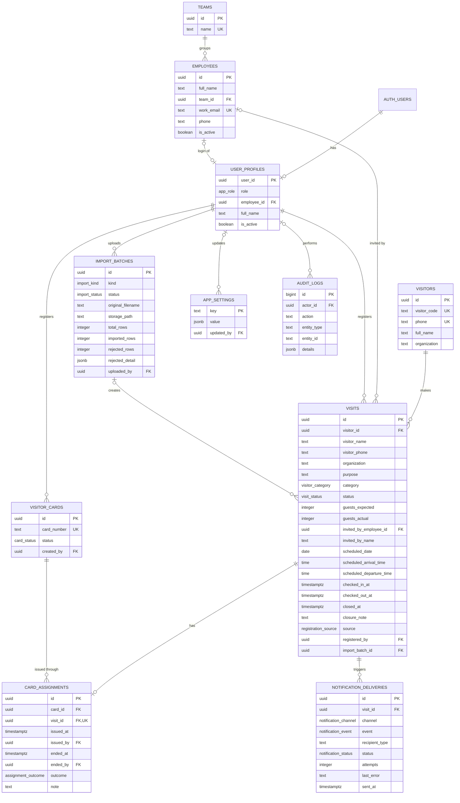

# NagorikPass Development PRD

The master technical specification for NagorikPass.

| Item | Value |
|---|---|
| Business source of truth | [`docs/source/REQUIREMENT_PRD.md`](../source/REQUIREMENT_PRD.md) |
| Status | Documentation written 2026-11-05, awaiting owner review. Owner decisions on OQ-1 to OQ-12 and OQ-15 applied the same day; OQ-13 and OQ-14 pending. |
| Implementation | Not started under this specification. A separate authorization is required. |

**How to read this document.** It holds key decisions, summaries and links. Each detail has one owning document:

| Detail | Owner |
|---|---|
| Glossary, actors, modules | [01-system-overview.md](01-system-overview.md) |
| Architecture and auth flows | [02-technical-architecture.md](02-technical-architecture.md) |
| Full DDL, RLS policies, database functions | [03-database-design.md](03-database-design.md) |
| Roles, permissions, account authorization | [04-user-roles-and-permissions.md](04-user-roles-and-permissions.md) |
| Server operations | [05-api-contracts.md](05-api-contracts.md) |
| Workflows and state changes | [06-business-workflows.md](06-business-workflows.md) |
| Security rules | [07-security-guidelines.md](07-security-guidelines.md) |
| Test catalogue | [08-testing-strategy.md](08-testing-strategy.md) |
| Environments and release steps | [09-deployment-guide.md](09-deployment-guide.md) |
| Phases and tasks | [10-development-roadmap.md](10-development-roadmap.md) |
| Visual design | [11-ui-design-system.md](11-ui-design-system.md) |

**Status tags.** PRD: stated in the Requirement PRD. Decision: decided by the project owner. Proposal: a technical recommendation inside an approved design. Open: not decided.

## 1. Project Overview

NagorikPass is a digital Visitor Management System that replaces manual visitor logs with one system for HR/Admin, Receptionists and Employees. Its goal is secure, organized, traceable and efficient visitor handling (PRD §1, §2).

**In scope:** visitor registration, expected visitors, check-in and check-out, visitor cards, notifications, employee and receptionist management, Excel imports, dashboards, history, reports and settings.

**Out of scope:** physical card-machine integration (PRD §6.4), entry for delivery personnel (PRD §5), storing identity documents (DEC-Q19), and any public or third-party API.

**Technology (PRD §8, unchanged):** Next.js App Router, TypeScript, Tailwind CSS, Server Actions and Route Handlers, Supabase PostgreSQL, Auth, Storage and Realtime, RBAC and RLS, ExcelJS, WhatsApp Cloud API, Telegram Bot API and Slack API, deployed on Vercel and Supabase. Telegram is the planned notification channel, and only HR/Admin receives notifications (OQ-3, OQ-4). The owner will implement Telegram later; until it exists, the PRD's manual fallback applies. WhatsApp and Slack stay in the stack but aren't built (DEC-Q12).

**Approved additions:** PDFKit for the PDF report, Vercel Cron for scheduled jobs, Zod for validation, `@supabase/ssr` for sessions, and Google as a Supabase Auth provider.

## 2. System Modules

Authentication and access, Dashboard, Visitor Management, Visitor History, Visitor Cards, Employee Management, Receptionist Management, Reports, Settings, Reception Home, Expected Visitors, Add New Visitor, Check-in and Check-out, Employee App, Notifications, and Interview Candidate Import. Details are in [01-system-overview.md](01-system-overview.md).

The PRD's Visitor Approval module is removed (DEC-Q1).

## 3. User and Access Management

There are three roles: HR/Admin (one role, DEC-Q9), Receptionist and Employee. Every employee has a directory entry and a login (DEC-Q9). HR/Admin invites people by email, and there is no public sign-up. The project owner creates the first HR/Admin once during setup.

### Sign-in methods

Both methods are available to all three roles on one login page:

1. **Email and password**, set by the user after accepting an invitation.
2. **Continue with Google** through Supabase Auth (DEC-G1). This is an owner requirement added on 2026-11-05. It isn't in the Requirement PRD. It accepts only accounts in the company's Google Workspace domain; personal Google accounts are refused (OQ-11).

Only company email addresses are used for invitations and sign-in. Personal email addresses aren't accepted, and a personal email can't be linked to an employee account (OQ-12). The company domain isn't documented yet: it is the configuration placeholder `COMPANY_EMAIL_DOMAIN`, **to be provided by the owner**.

### Rule for every sign-in

**Proving identity never grants access.** For Google, the server first checks that the verified email belongs to the company domain. Passing that check still grants nothing: after either method, NagorikPass requires an active `user_profiles` row with an assigned role. Without one, the session is ended and access is denied. Profiles are created only by the invitation process, never from a Google email address. The full rules are in [04-user-roles-and-permissions.md](04-user-roles-and-permissions.md#account-authorization) and the flow is in [02-technical-architecture.md](02-technical-architecture.md#google-sign-in-flow).

## 4. Database Architecture and Complete Schema

The complete DDL is in [03-database-design.md](03-database-design.md), as approved (J3). This section has the summary and ERD. No migration has been created.

| Table | Purpose | Basis |
|---|---|---|
| `user_profiles` | Links a login to a role and an active state | Proposal |
| `teams` | Team names | PRD |
| `employees` | Directory, separate from logins | PRD |
| `visitors` | One person per phone number, with a Visitor ID that HR/Admin assigns once | DEC-Q6, OQ-1 |
| `visits` | One row per visit | PRD |
| `visitor_cards` | Unique card number and current status | PRD |
| `card_assignments` | Permanent issue and return history | PRD |
| `import_batches` | Upload result and rejected rows | Proposal |
| `notification_deliveries` | Send attempts and failures of HR/Admin notifications | Proposal, OQ-3 |
| `app_settings` | Configuration | PRD, DEC-Q17 |
| `audit_logs` | Accounts, cards, lost-card closures | DEC-T9 |

Not created: permission tables (DEC-T10), approval records (DEC-Q1), group members (DEC-Q3).

**Visit statuses:** `expected`, `checked_in`, `checked_out`, `closed_card_lost`, `no_show`, `cancelled`, `not_permitted`.

**Card statuses:** `available`, `issued`, `lost`, `damaged`, `retired`.

**Active visit statuses:** `expected` and `checked_in`. One phone number can have only one active visit at a time; a new visit is allowed once the previous one has ended (OQ-10).

**Visitor ID and card number are different things.** The Visitor ID (`visitors.visitor_code`) is a permanent identifier that HR/Admin assigns by hand, once per visitor (OQ-1). A visitor card number (`visitor_cards.card_number`) belongs to a reusable physical card: after a confirmed return the card is Available and the Receptionist can issue it to another visitor.

Google Sign-In adds no tables or columns. Supabase Auth stores linked identities in its own schema.

## 5. Role and Permission Matrix

Permissions are defined in code and enforced by database policies and functions (DEC-T10). The explanation is in [04-user-roles-and-permissions.md](04-user-roles-and-permissions.md).

| Permission | HR/Admin | Receptionist | Employee |
|---|---|---|---|
| `visit.create` | Yes | Yes, unscheduled, today | Own |
| `visit.log_delivery` | No | Yes | No |
| `visit.read` | All | Expected, checked in and today's | Own |
| `visit.update` (before check-in) | Yes | Yes | Own |
| `visit.cancel` (before check-in) | Yes | No | Own |
| `visit.delete` | No | No | No |
| `visit.approve`, `visit.reject` | Removed (DEC-Q1) | Removed (DEC-Q1) | Removed (DEC-Q1) |
| `visit.check_in`, `visit.check_out` | No | Yes | No |
| `card.read` | Yes | Yes | No |
| `card.manage` (register, import, edit number, retire) | Yes | No | No |
| `card.resolve_loss` | Yes | No | No |
| `visitor.assign_code` (Visitor ID) | Yes | No | No |
| `import.run` | Yes | No | No |
| `report.view`, `report.export`, `history.view`, `dashboard.view` | Yes | No | No |
| `reception_home.view` | No | Yes | No |
| `employee.manage`, `team.manage` | Yes | No | No |
| `employee.directory_read` | Full record | Name and team only | No |
| `receptionist.manage` | Yes | No | No |
| `settings.manage` | Yes | No | No |
| `audit.read` | Yes | No | No |
| `notification.receive` | Yes | No | No (OQ-3) |
| `notification.retry` | Yes | Yes | No |
| `account.self` (sign in, Google, sign out) | Yes | Yes | Yes |

## 6. Application Architecture

Next.js on Vercel serves all three role areas from one application. Server Components read data under the user's session, so RLS always applies. Server Actions handle UI mutations. Route Handlers exist only where a URL is required. All visit and card state changes run in transactional Postgres functions. The service-role key is used only in server-only code, for account administration and scheduled jobs. See [02-technical-architecture.md](02-technical-architecture.md).

## 7. API Specification

Contracts are in [05-api-contracts.md](05-api-contracts.md). There is no public API.

| Type | Operations |
|---|---|
| Auth actions | `signIn`, `signInWithGoogle`, `signOut`, `setPassword` |
| Visit actions | `registerVisit`, `updateVisit`, `cancelVisit`, `logDeliveryVisitor`, `searchHosts`, `assignVisitorCode` |
| Check-in and check-out | `checkIn`, `checkOutConfirmReturn`, `resolveLostCard` |
| Cards and imports | `createCard`, `updateCardNumber`, `importCards`, `retireCard`, `importCandidates` |
| People | `createTeam`, `updateTeam`, `createEmployee`, `updateEmployee`, `setEmployeeActive`, `inviteUser`, `setUserActive` |
| Other | `updateSettings`, `retryNotification` |
| Route Handlers | `GET /auth/callback`, `GET /auth/confirm`, `GET /auth/denied`, `GET /api/reports/visits.pdf`, `GET /api/reports/visits.xlsx`, `GET /api/cron/mark-no-shows`, `GET /api/cron/retry-notifications` |

## 8. Business Workflows

Workflows A to F, delivery handling, standard check-in and check-out, lost cards, no-shows, cancellation, imports and notifications are in [06-business-workflows.md](06-business-workflows.md). The check-out popup wording is fixed by the PRD: **"Did you get the visitor card back?"**

## 9. Security and Data Protection

Authorization is enforced in the database and server, never only in the UI. Key rules are in [07-security-guidelines.md](07-security-guidelines.md): role validation after every sign-in, a server-side company-domain check for Google (OQ-11), company email addresses only (OQ-12), public sign-up disabled, OAuth secrets stored only in Supabase and never in the application, private Storage, validated uploads, and limited audit logging.

Visitor data is kept indefinitely (DEC-Q20). That is a privacy and legal exposure the owner has accepted for now, and no deletion process exists.

## 10. Testing Strategy

The layers and full catalogue are in [08-testing-strategy.md](08-testing-strategy.md). Authorization tests cover every role against every table, and each auth failure case for Google has its own test.

## 11. Deployment and Infrastructure

Development, staging (DEC-T8) and production are in [09-deployment-guide.md](09-deployment-guide.md), including the Google Cloud and Supabase settings needed later. No hosted or external configuration has been changed.

## 12. Development Phases and Task Breakdown

Full tasks and acceptance criteria are in [10-development-roadmap.md](10-development-roadmap.md). No task has been completed under this specification.

| Phase | Objective |
|---|---|
| 0 | Compare the existing app with this design and decide its future (DEC-Q21) |
| 1 | Schema, RLS, roles, authentication including Google |
| 2 | Teams, employees, accounts |
| 3 | Visitors, visits, registration |
| 4 | Cards, check-in and check-out, lost cards |
| 5 | Excel imports |
| 6 | Notifications, Realtime, scheduled jobs |
| 7 | Dashboard, history, reports, settings |
| 8 | PWA, full testing, deployment |

## 13. Requirement Traceability

Every statement in the Requirement PRD has a row. IDs follow the PRD section. Open a row's PRD section to read the original wording. Where a decision changes the PRD text, the row says so.

| Original Requirement | Module | Database Entity | API/Server Operation | Permission | Development Phase | Test Case |
|---|---|---|---|---|---|---|
| REQ-1-01 (§1) Centralized platform replacing manual logs | All | All | All | All | 1–8 | TC-UI-01 |
| REQ-1-02 (§1) Role-based access protects information | Access | `user_profiles` | All | All | 1 | TC-RLS-05 |
| REQ-3-01 (§3) HR/Admin manages employees, receptionists, visitor records | Employees, Receptionists, Visitors | `employees`, `user_profiles`, `visits` | `createEmployee`, `inviteUser`, `updateVisit` | `employee.manage`, `receptionist.manage` | 2, 3 | TC-EMP-01 |
| REQ-3-02 (§3) HR/Admin registers expected visitors | Visitor Management | `visits` | `registerVisit` | `visit.create` | 3 | TC-VIS-04 |
| REQ-3-03 (§3) HR/Admin monitors dashboards, history, reports | Dashboard, History, Reports | `visits` | Server Component reads | `dashboard.view`, `history.view`, `report.view` | 7 | TC-DASH-01 |
| REQ-3-04 (§3) HR/Admin notified at check-in | Notifications | `notification_deliveries` | `checkIn` | `notification.receive` | 6 | TC-NOT-01 |
| REQ-3-05 (§3) HR/Admin adds employee-initiated visitors. DEC-Q2: also direct | Visitor Management | `visits` | `registerVisit` | `visit.create` | 3 | TC-VIS-04 |
| REQ-3-06 (§3) HR/Admin registers cards and monitors them | Visitor Cards | `visitor_cards`, `card_assignments` | `createCard`, `importCards` | `card.manage` | 4 | TC-CARD-14 |
| REQ-3-07 (§3) HR/Admin uploads candidates, registers VIP visits and groups | Import, Visitor Management | `import_batches`, `visits` | `importCandidates`, `registerVisit` | `import.run`, `visit.create` | 3, 5 | TC-IMP-01 |
| REQ-3-08 (§3) Receptionist views expected, registers unscheduled | Reception | `visits` | `registerVisit` | `visit.read`, `visit.create` | 3 | TC-VIS-05 |
| REQ-3-09 (§3) Receptionist searches for employees | Add New Visitor | `employees`, `teams` | `searchHosts` | `employee.directory_read` | 3 | TC-RLS-01 |
| REQ-3-10 (§3) Receptionist checks visitors in and out | Check-in/out | `visits` | `checkIn`, `checkOutConfirmReturn` | `visit.check_in`, `visit.check_out` | 4 | TC-CARD-05 |
| REQ-3-11 (§3) Receptionist manages visitor information on web and mobile | Reception | `visits` | `updateVisit` | `visit.update` | 3, 8 | TC-VIS-17 |
| REQ-3-12 (§3) Receptionist assigns card and confirms return | Check-in/out | `card_assignments` | `checkIn`, `checkOutConfirmReturn` | `visit.check_in`, `visit.check_out` | 4 | TC-CARD-06 |
| REQ-3-13 (§3) Receptionist does not check in delivery personnel | Check-in/out | `visits` | `checkIn` | `visit.check_in` | 4 | TC-VIS-14 |
| REQ-3-14 (§3) Employee coordinates with HR/Admin and provides information. DEC-Q2: also direct | Employee App | `visits` | `registerVisit` | `visit.create` | 3 | TC-VIS-03 |
| REQ-3-15 (§3) Employee is responsible for invited visitors | Employee App | `visits` | `registerVisit` | `visit.read` | 3 | TC-RLS-02 |
| REQ-4-01 (§4) Eight visitor categories | Visitor Management | `visits.category` | `registerVisit` | `visit.create` | 3 | TC-VIS-02 |
| REQ-4-02 (§4) Record holds host, schedule, actual times, card | Visitor Management | `visits`, `card_assignments` | `registerVisit`, `checkIn` | `visit.read` | 3, 4 | TC-VIS-19 |
| REQ-4.1-01 (§4.1) Name, phone, purpose mandatory | Registration | `visits`, `visitors` | `registerVisit` | `visit.create` | 3 | TC-VIS-01 |
| REQ-4.1-02 (§4.1) Guests, Invited By, organization captured | Registration | `visits` | `registerVisit` | `visit.create` | 3 | TC-VIS-19 |
| REQ-5.CI-01 (§5) Receptionist registers or finds visitor | Reception | `visits` | `registerVisit` | `visit.create`, `visit.read` | 3 | TC-VIS-05 |
| REQ-5.CI-02 (§5) Select available card from dropdown | Check-in/out | `visitor_cards` | Read under RLS | `card.read` | 4 | TC-CARD-03 |
| REQ-5.CI-03 (§5) Check-in links card to record | Check-in/out | `card_assignments` | `checkIn` | `visit.check_in` | 4 | TC-CARD-05 |
| REQ-5.CI-04 (§5) Records time, card Available to Issued | Check-in/out | `visits`, `visitor_cards` | `checkIn` | `visit.check_in` | 4 | TC-CARD-05 |
| REQ-5.CI-05 (§5) Dashboard shows card and visitor; HR/Admin notified | Dashboard, Notifications | `notification_deliveries` | `checkIn` | `dashboard.view` | 6, 7 | TC-RT-01 |
| REQ-5.CO-01 (§5) Visitor returns the card | Check-in/out | `card_assignments` | `checkOutConfirmReturn` | `visit.check_out` | 4 | TC-CARD-06 |
| REQ-5.CO-02 (§5) Popup "Did you get the visitor card back?" | Check-in/out | None | UI | `visit.check_out` | 4 | TC-CARD-08 |
| REQ-5.CO-03 (§5) Yes: time, Checked Out, card Available, dashboard | Check-in/out | `visits`, `visitor_cards` | `checkOutConfirmReturn` | `visit.check_out` | 4 | TC-CARD-06 |
| REQ-5.CO-04 (§5) No: incomplete, stays Checked In, card assigned | Check-in/out | `visits` | `checkOutConfirmReturn` | `visit.check_out` | 4 | TC-CARD-07 |
| REQ-5.CO-05 (§5) History keeps issued and returned time | Visitor Cards | `card_assignments` | `checkIn`, `checkOutConfirmReturn` | `card.manage` | 4 | TC-CARD-09 |
| REQ-5.A-01 (§5A) HR/Admin pre-registers; visitor in Expected | Visitor Management | `visits` | `registerVisit` | `visit.create` | 3 | TC-VIS-04 |
| REQ-5.A-02 (§5A) Receptionist verifies identity. DEC-Q19: visual | Expected Visitors | None | UI | `visit.check_in` | 4 | TC-UI-01 |
| REQ-5.B-01 (§5B) Employee registers without approval | Employee App | `visits` | `registerVisit` | `visit.create` | 3 | TC-VIS-03 |
| REQ-5.B-02 (§5B) Appears in Expected, dashboard and records | Reception, Dashboard | `visits` | Read under RLS | `visit.read` | 3, 7 | TC-VIS-03 |
| REQ-5.B-03 (§5B) Employee and HR/Admin notified at check-in. OQ-3: HR/Admin only | Notifications | `notification_deliveries` | `checkIn` | `notification.receive` | 6 | TC-NOT-02 |
| REQ-5.C-01 (§5C) Receptionist registers and searches host | Add New Visitor | `visits` | `registerVisit`, `searchHosts` | `visit.create` | 3 | TC-VIS-05 |
| REQ-5.C-02 (§5C) Not found: confirmed name in Invited By | Add New Visitor | `visits.invited_by_name` | `registerVisit` | `visit.create` | 3 | TC-VIS-06 |
| REQ-5.C-03 (§5C) No additional employee approval | Check-in/out | `visits` | `checkIn` | `visit.check_in` | 4 | TC-VIS-05 |
| REQ-5.D-01 (§5D) Personal guest recorded with Invited By and type | Add New Visitor | `visits` | `registerVisit` | `visit.create` | 3 | TC-VIS-10 |
| REQ-5.E-01 (§5E) Candidate Excel feeds Expected Visitors | Import | `import_batches`, `visits` | `importCandidates` | `import.run` | 5 | TC-IMP-01 |
| REQ-5.F-01 (§5F) VIP with expected guests; actual count verified | Visitor Management, Check-in | `visits.guests_expected`, `visits.guests_actual` | `registerVisit`, `checkIn` | `visit.create` | 3, 4 | TC-VIS-11 |
| REQ-5.F-02 (§5F) "Visitor cards" issued. DEC-Q3: one card per group | Check-in/out | `card_assignments` | `checkIn` | `visit.check_in` | 4 | TC-VIS-12 |
| REQ-5.DEL-01 (§5) Delivery not permitted, no check-in, no card. DEC-Q8: logged | Add New Visitor | `visits` | `logDeliveryVisitor` | `visit.log_delivery` | 3 | TC-VIS-14 |
| REQ-6.1-01 (§6.1) HR/Admin sidebar. DEC-Q1: no Visitor Approval | Layout | None | UI | `dashboard.view` | 7 | TC-UI-01 |
| REQ-6.1-02 (§6.1) Dashboard KPIs, graphs, timeline. DEC-Q1 removes two KPIs. OQ-2: today's figures | Dashboard | `visits` | Read under RLS | `dashboard.view` | 7 | TC-DASH-01 |
| REQ-6.1-03 (§6.1) Add via modal, VIP, candidate upload | Visitor Management | `visits` | `registerVisit`, `importCandidates` | `visit.create` | 3, 5 | TC-VIS-04 |
| REQ-6.1-04 (§6.1) Visitor Approval. Removed by DEC-Q1 | None | None | None | None | None | TC-UI-01 |
| REQ-6.1-05 (§6.1) Search history | History | `visits`, `card_assignments` | Read under RLS | `history.view` | 7 | TC-VIS-20 |
| REQ-6.1-06 (§6.1) Manage employees | Employee Management | `employees`, `teams` | `createEmployee`, `updateEmployee` | `employee.manage` | 2 | TC-EMP-01 |
| REQ-6.1-07 (§6.1) Manage receptionist accounts and access | Receptionist Management | `user_profiles` | `inviteUser`, `setUserActive` | `receptionist.manage` | 2 | TC-EMP-05 |
| REQ-6.1-08 (§6.1) Reports with arrival, departure and PDF. DEC-Q16: also Excel | Reports | `visits` | `GET /api/reports/visits.pdf`, `GET /api/reports/visits.xlsx` | `report.export` | 7 | TC-RPT-02 |
| REQ-6.1-09 (§6.1) Manage configuration. DEC-Q17 | Settings | `app_settings` | `updateSettings` | `settings.manage` | 7 | TC-SET-01 |
| REQ-6.2-01 (§6.2) Reception on web and mobile; Home, Expected, Add New | Reception | None | UI | `reception_home.view` | 3, 8 | TC-UI-02 |
| REQ-6.2-02 (§6.2) Home counts and today's list | Reception Home | `visits` | Read under RLS | `reception_home.view` | 7 | TC-DASH-04 |
| REQ-6.2-03 (§6.2) Find and verify, check in with timestamps | Expected Visitors | `visits` | `checkIn` | `visit.check_in` | 4 | TC-VIS-18 |
| REQ-6.2-04 (§6.2) Add unscheduled with additional fields | Add New Visitor | `visits` | `registerVisit` | `visit.create` | 3 | TC-VIS-05 |
| REQ-6.3-01 (§6.3) Automatic notification with visitor details | Notifications | `notification_deliveries` | `checkIn` | `notification.receive` | 6 | TC-NOT-01 |
| REQ-6.3-02 (§6.3) WhatsApp or Telegram. DEC-Q12: Telegram first | Notifications | `notification_deliveries` | Notification sender | `notification.receive` | 6 | TC-NOT-01 |
| REQ-6.3-03 (§6.3) Manual fallback by the Receptionist. OQ-9: calls aren't recorded | Notifications | `notification_deliveries` | `retryNotification` | `notification.retry` | 6 | TC-NOT-05 |
| REQ-6.4-01 (§6.4) Bulk card upload | Visitor Cards | `visitor_cards`, `import_batches` | `importCards` | `card.manage` | 5 | TC-CARD-02 |
| REQ-6.4-02 (§6.4) Manual card entry. OQ-7: card numbers can be corrected | Visitor Cards | `visitor_cards` | `createCard`, `updateCardNumber` | `card.manage` | 4 | TC-CARD-01, TC-CARD-16 |
| REQ-6.4-03 (§6.4) Unique Card Number/ID | Visitor Cards | `visitor_cards` | `createCard` | `card.manage` | 4 | TC-CARD-01 |
| REQ-6.4-04 (§6.4) New cards appear for the Receptionist | Check-in/out | `visitor_cards` | Read under RLS | `card.read` | 4 | TC-CARD-15 |
| REQ-6.4-05 (§6.4) HR/Admin views all cards | Visitor Cards | `visitor_cards` | Read under RLS | `card.read` | 4 | TC-CARD-14 |
| REQ-6.4-06 (§6.4) Monitoring fields | Visitor Cards | `card_assignments`, `visits` | Read under RLS | `card.manage` | 4 | TC-CARD-14 |
| REQ-6.4-07 (§6.4) Exactly one status, Available or Issued. DEC-Q4 adds three | Visitor Cards | `visitor_cards.status` | `resolveLostCard`, `retireCard` | `card.resolve_loss` | 4 | TC-CARD-10 |
| REQ-6.4-08 (§6.4) History fields | Visitor Cards | `card_assignments` | Read under RLS | `card.manage` | 4 | TC-CARD-09 |
| REQ-6.4-09 (§6.4) Dashboard shows details and reflects check-out | Dashboard | `visits`, `visitor_cards` | Realtime | `dashboard.view` | 6, 7 | TC-RT-01 |
| REQ-6.4-10 (§6.4) No physical card machine integration | None | None | None | None | None | TC-UI-01 |
| REQ-6.5-01 (§6.5) Candidates import, then find and check in | Import | `import_batches`, `visits` | `importCandidates` | `import.run` | 5 | TC-IMP-01 |
| REQ-6.6-01 (§6.6) Stored fields for every visit. OQ-1: Visitor ID assigned by HR/Admin | History | `visits`, `visitors`, `card_assignments` | Read under RLS, `assignVisitorCode` | `history.view`, `visitor.assign_code` | 3, 7 | TC-VIS-19, TC-VIS-23 |
| REQ-7-01 (§7) Employees register without approval | Employee App | `visits` | `registerVisit` | `visit.create` | 3 | TC-VIS-03 |
| REQ-7-02 (§7) Unscheduled needs no extra approval | Check-in/out | `visits` | `checkIn` | `visit.check_in` | 4 | TC-VIS-05 |
| REQ-7-03 (§7) Access restricted by role | Access | All | All | All | 1 | TC-RLS-05 |
| REQ-7-04 (§7) Receptionists see employee name and team only | Add New Visitor | `employees` | `searchHosts` | `employee.directory_read` | 3 | TC-RLS-01 |
| REQ-7-05 (§7) Delivery personnel not checked in | Check-in/out | `visits` | `checkIn` | `visit.check_in` | 4 | TC-VIS-14 |
| REQ-7-06 (§7) Check-out only after card-return confirmation | Check-in/out | `visits` | `checkOutConfirmReturn` | `visit.check_out` | 4 | TC-CARD-07 |
| REQ-7-07 (§7) Cards managed only by HR/Admin | Visitor Cards | `visitor_cards` | `createCard` | `card.manage` | 4 | TC-RLS-04 |
| REQ-8-01 (§8) Stack as listed | All | All | All | None | 1–8 | TC-UI-04 |
| REQ-8-02 (§8) Excel import with ExcelJS | Import | `import_batches` | `importCandidates`, `importCards` | `import.run` | 5 | TC-IMP-04 |
| REQ-8-03 (§8) Supabase Storage. DEC-Q18 | Import | `import_batches.storage_path` | `importCandidates`, `importCards` | `import.run` | 5 | TC-IMP-05 |
| REQ-8-04 (§8) WhatsApp, Telegram and Slack. DEC-Q12 | Notifications | `notification_deliveries` | Notification sender | `notification.receive` | 6 | TC-NOT-01 |
| REQ-8-05 (§8) Supabase Realtime | Dashboard, Reception | `visits`, `visitor_cards` | Realtime | `dashboard.view` | 6 | TC-RT-02 |
| REQ-8-06 (§8) Vercel and Supabase deployment | Infrastructure | None | None | None | 8 | TC-UI-04 |
| REQ-8-07 (§8) Admin/HR and Employee web; Receptionist responsive PWA | Layout | None | UI | None | 8 | TC-UI-03 |
| DEC-G1 (owner) Continue with Google, role check, no automatic access. OQ-11: company domain only | Authentication | `user_profiles` | `signInWithGoogle`, `GET /auth/callback` | `account.self` | 1 | TC-AUTH-02, TC-AUTH-03, TC-AUTH-15 |

**Unresolved rows:** none are unmapped. Rows naming an OQ are mapped but depend on that open question.

## 14. Open Questions and Decisions

### Owner decisions

| ID | Decision |
|---|---|
| DEC-Q1 | Visitor Approval removed: no page, no Pending Approval or Rejected counts. **Differs from PRD §6.1.** |
| DEC-Q2 | Employees register directly; HR/Admin can also add a visitor for an employee and record who invited them |
| DEC-Q3 | One card per visit or group, guests as a count only, for all visit types; VIP visits record expected and actual counts. **Narrows PRD §5F.** |
| DEC-Q4 | Lost or damaged cards are resolved by HR/Admin with a required note; the visit closes as Closed: card lost and the card leaves use. **Adds to PRD §6.4.** |
| DEC-Q5 | Completed means Checked Out; automatic No-Show after the scheduled day; Cancelled before check-in. **Adds statuses.** |
| DEC-Q6 | Same phone means same visitor; each visit keeps the name as entered |
| DEC-Q7 | One Invited By field, required before check-in, picked from the list or typed |
| DEC-Q8 | Couriers are logged only, never checked in, never given a card |
| DEC-Q9 | Name, team, work email, phone, active state; every employee has a login; email invitation; one HR/Admin role; owner creates the first HR/Admin |
| DEC-Q10 | Employees view, edit and cancel their own visitors before check-in; own means registered by them or naming them in Invited By; no directory access |
| DEC-Q11 | Receptionists edit before check-in and can't cancel; only Receptionists check in and out |
| DEC-Q12 | Telegram as the channel; Slack later. **Updated by OQ-3 and OQ-4:** only HR/Admin receives notifications, and the owner will implement Telegram later |
| DEC-Q13 | Fixed templates; valid rows import and rejected rows are listed; duplicate rows are rejected and reported |
| DEC-Q14 | No available card blocks check-in; the Receptionist contacts HR/Admin |
| DEC-Q15 | Date required, defaulting to today; time optional; Expected Visitors shows today, with future dates through a filter |
| DEC-Q16 | Filters: date, category, status, host. Exports: PDF and Excel. Couriers excluded from Total Visitors. |
| DEC-Q17 | Settings: organization name, time zone, notification channels and recipients |
| DEC-Q18 | Uploaded Excel files kept in a private bucket |
| DEC-Q19 | Identity check is visual, and nothing is stored |
| DEC-Q20 | English; Asia/Dhaka; one organization and site; data kept indefinitely; no fixed performance or availability targets |
| DEC-Q21 | Design from the PRD, then compare with the existing app and decide separately |
| DEC-T1 | Privileged work moves from Edge Functions to server-only Next.js code |
| DEC-T2 | TanStack Query left out |
| DEC-T3 | One PDF library: PDFKit (chosen in [02](02-technical-architecture.md#pdf-and-excel-reports)) |
| DEC-T5 | Vercel Cron |
| DEC-T6 | Zod |
| DEC-T8 | Staging environment included |
| DEC-T9 | Audit logs limited to accounts, cards and lost-card closures |
| DEC-T10 | Role enum, no permission tables |
| DEC-J10 | HR/Admin can retire a card that isn't on a visit, keeping its history |
| DEC-G1 | Continue with Google added for all roles through Supabase Auth, in addition to email and password. Google never grants access by itself. |

### Open questions

The owner decided OQ-1 to OQ-12 and OQ-15 on 2026-11-05. OQ-13 and OQ-14 are still pending. A decided question no longer blocks a phase. Where a decision leaves a detail undefined, it is listed under "Details still needed" below rather than filled in here.

| ID | Question | Status | Decision or current handling | Blocks |
|---|---|---|---|---|
| OQ-1 | Visitor ID: who sets it, and in what format? | Decided | HR/Admin assigns each visitor's ID by hand, once, and it stays with that visitor. Receptionists and employees don't set it. There is no automatic generator unless the owner approves one. The Visitor ID (`visitors.visitor_code`) is never a card number: visitor cards are reusable and pass from visitor to visitor. | None |
| OQ-2 | What period does Total Visitors cover, and what do the graphs and timeline show? | Decided | Today only, in the organization's time zone. Dashboard counts and activity visuals use today's date unless another period is stated. Couriers stay excluded. | None |
| OQ-3 | Are hosts or employees notified? | Decided | No. Only HR/Admin receives visitor notifications, in every workflow (A to F). **Differs from PRD §5B step 8**, which also notifies the registering employee. | None |
| OQ-4 | Telegram linking for employees | Decided | Not required. Only HR/Admin receives notifications, through the HR/Admin chat set in Settings. The owner will implement Telegram later; the integration stays in the architecture. No employee linking, and no employee notification failures or retries. | None |
| OQ-5 | Phone format | Decided | Bangladeshi numbers only; international numbers aren't supported. Numbers are validated and normalized the same way everywhere and stored as `+880…`. | None |
| OQ-6 | Is employee phone required? | Decided | Optional. Work email is required. | None |
| OQ-7 | How is a wrongly entered card number corrected? | Decided | HR/Admin edits the card number. Numbers stay unique, and the card's assignment history is kept because it refers to the card, not the number. No retire-and-re-add. | None |
| OQ-8 | What happens to upcoming visits when their host is deactivated? | Decided | Existing and upcoming visits are kept with their history. HR/Admin is notified of the affected upcoming visits. A deactivated employee can't be chosen as host for new registrations. | None |
| OQ-9 | Should a manual call to HR/Admin be recorded? | Decided | No. There is no call log. | None |
| OQ-10 | Can one phone number have two active visits at once? | Decided | No. Active statuses are `expected` and `checked_in`. A new visit for that number is allowed once the previous visit has ended (checked out, closed, cancelled or no-show). Enforced in the application and the database. | None |
| OQ-11 | Should Google Sign-In be limited to the company Google Workspace domain? | Decided | Yes. Personal Google accounts are refused. The domain is checked on the server. Passing it doesn't replace authorization: an active profile with a role is still required. The domain value is a placeholder until the owner provides it. | Phase 1 needs the domain value |
| OQ-12 | Personal or differing email addresses | Decided | Not allowed. Only company email addresses are used for invitations and authentication, and a personal email can't be linked to an employee account. | None |
| OQ-13 | Which email service delivers invitations in production? | **Pending Decision** | The owner will choose. Production needs a dedicated email service for invitations, because Supabase's default email isn't meant for production volume. No provider is chosen here. | Phase 2 (production invitations) |
| OQ-14 | Which Vercel plan is used? | **Pending Decision** | Not decided; neither Hobby nor Pro is assumed. The daily No-Show job (`mark-no-shows`) works on any plan. How often failed notifications are retried depends on the plan and stays unresolved. | Phase 6 (retry schedule) |
| OQ-15 | Official brand color and company image | Decided | The color tokens in [11-ui-design-system.md](11-ui-design-system.md) are the official values. The company image is in the repository at `design_resources/visitx/nagorik.jpeg`, unchanged. | None |

### Details still needed

These follow from the decisions above and need the owner's input. Nothing has been invented for them.

| Related | Missing detail | Handling until decided |
|---|---|---|
| OQ-11, OQ-12 | The company Google Workspace and email domain | Configuration placeholder `COMPANY_EMAIL_DOMAIN`, owner to provide |
| OQ-1 | Visitor ID format, and whether a visit can be checked in before HR/Admin has assigned the ID (walk-ins and employee registrations arrive without one) | Free text, unique, optional at check-in |
| OQ-1 | How a mistyped Visitor ID is corrected, since it is assigned once | No edit operation |
| OQ-2 | Whether cancelled visits count in Total Visitors | Counted, because only couriers are excluded |
| OQ-4 | Whether Telegram is still built in Phase 6 or after launch | Kept in Phase 6, implemented when the owner schedules it; the PRD's manual fallback covers the gap |
| OQ-5 | Whether landline numbers are accepted, and whether employee phones must also be Bangladeshi | Mobile format `+8801[3-9]XXXXXXXX` for visitors; employee phone format unchanged |
| OQ-10 | A visitor with a future booking can't be booked for a second date until the first visit ends | Applied as decided |
| OQ-15 | A usable logo file (SVG or PNG) for the app's header; the supplied image is a photo of the sign | Product name in text until supplied |

### Temporary assumptions

These aren't approved requirements: the handling listed under "Details still needed", the items marked Proposal elsewhere in this specification, and that an invited user's company Google identity links to their existing account, which must be verified in Phase 1 (TC-AUTH-10).
